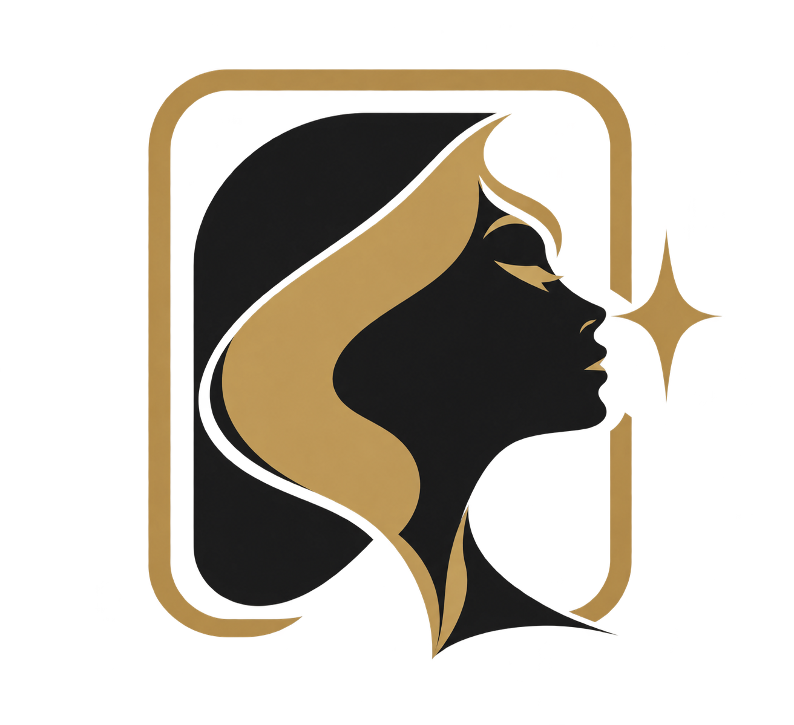

# MUSE FRAME · 映象所

A local-first AI portrait photography workspace. Plan your shoot, organize references and create through your own image platform.

**[简体中文](README.zh-CN.md) · [Download for Mac](https://github.com/KaneGong/muse-frame/releases/tag/v0.4.0-beta.1) · [Quick start](docs/en/quick-start.md) · [Report a bug](https://github.com/KaneGong/muse-frame/issues/new/choose)**

**Community preview · 0.4.0-beta.1 · AGPL-3.0-only**

This is an early public preview for feedback. Current downloadable App: **macOS 26+, Apple Silicon (arm64)**. It uses an ad-hoc signature and is **not Apple-notarized**. Windows and Intel Mac binaries are not available in this release.

## What it does

- Organize face, body, outfit, environment and pose references in local projects.
- Plan multiple shots with separate pose, framing, position and subject-size choices.
- Connect your own Lovart or LibTV account and generate through the platform's available models.
- Request 1–4 images **per shot**; multiple shots are separate shot configurations.
- Review results, edit through text instructions, adjust color locally, and export originals.
- Browse online reference libraries; preview before selecting up to 10 images per import. Imported references are not automatically applied to your shoot.
- Switch the interface between English and Simplified Chinese. User-authored prompts are preserved; some connection statuses, diagnostics, built-in prompt text and upstream gallery labels remain Chinese.

MUSE FRAME does not train or bundle a generation model. Platform availability, costs, review policies and generation quality remain with your chosen provider. It is an independent project, not an official Lovart or LibTV product.

## Start creating

1. Download the Apple Silicon DMG from **[Releases](https://github.com/KaneGong/muse-frame/releases/tag/v0.4.0-beta.1)**, read its installation notes and copy the App to Applications.
2. Open **Connect & settings** and authorize your own platform account. A new installation does not copy another app's login or create paid tasks automatically.
3. Create a project, choose references, configure shots and submit when ready. Generation consumes your platform credits.

For the browser UI, use the [source quick start](docs/en/quick-start.md). It runs on your computer; this release is not a hosted multi-user service.

## Privacy and requirements

Projects and downloaded assets are stored locally. **Prompts and selected reference images are sent to the connected platform when you submit work.** Online galleries contact their source hosts. See [privacy](docs/en/privacy.md).

An account, available platform credits and network access are required for generation. Basic project preparation and local color adjustment do not need a new generation task. The App bundles Python; source users install Python dependencies themselves.

## Preview limits

See [compatibility and known limitations](docs/en/compatibility.md). A connected model catalog is not proof that every model and parameter combination has been tested. Subject-size percentages are approximate prompt targets, not guaranteed geometric controls.

Use the standard [Apple guidance](https://support.apple.com/en-us/102445) if macOS blocks an unnotarized build. We do not ask users to disable Gatekeeper globally.

## Feedback and development

[Issues](https://github.com/KaneGong/muse-frame/issues/new/choose): reproducible bugs. [Discussions](https://github.com/KaneGong/muse-frame/discussions): questions, ideas and workflows when enabled. Never attach tokens, private photos or a complete user database to a public report.

[Contributing](CONTRIBUTING.md) · [Security](SECURITY.md) · [Changelog](CHANGELOG.md) · [Build instructions](docs/en/build.md)

## License and credits

Project software is licensed under **[AGPL-3.0-only](LICENSE)**. Commercial use is allowed under its conditions. Third-party code, reference images and brand assets have separate notices: [dependencies](THIRD_PARTY_NOTICES.md), [assets](ASSET_LICENSES.md), [brand](TRADEMARKS.md).

Corresponding source is in this repository at each release tag and included alongside the App in the DMG. Preserve the source offer when redistributing or modifying the software, and follow the network-source obligations where applicable.

Online reference-library contributors are credited in the App and in the asset notices. No third-party gallery original images or user projects are included in this repository.
