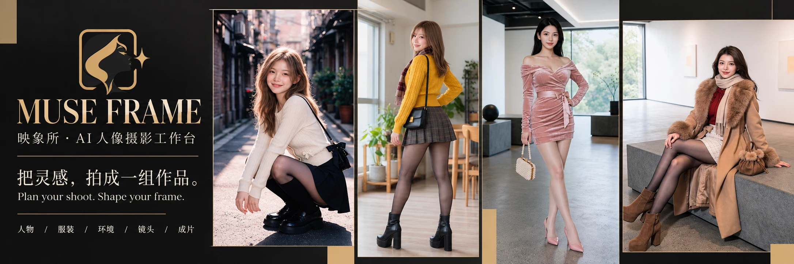
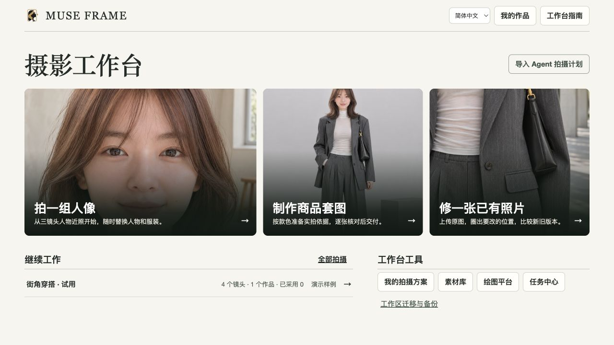

# MUSE FRAME · 映象所

MUSE FRAME is a local AI portrait workspace for Mac and Windows. Choose a person, outfit, scene and pose, then set the framing and tone for your first photo. Advanced controls let you refine lighting, body reference and shot settings. Projects, saved images and task history stay on your computer. Confirming a task sends its selected references and prompt to your connected Lovart, LibTV or Ark account.

**[Download 0.6.1](https://github.com/KaneGong/muse-frame/releases/tag/v0.6.1) · [Agent plugins](docs/agent-plugins.md) · [Install and migrate](docs/en/quick-start.md) · [简体中文](README.zh-CN.md)**

## Photography studio 0.6.1

Start a portrait series, a product batch, or a retouch from Home. Resume previous work and import a reviewed shot plan from your agent. The stable app continues to use the MUSE FRAME workspace and local port 9014. Existing Studio Preview workspaces remain separate. Portrait shoots use their own references, drafts and frame settings.

| Download | Installation |
| --- | --- |
| Apple Silicon Mac DMG | Drag Muse Frame into Applications. The Mac app is ad-hoc signed and unnotarized. Requires macOS 12 or later. |
| Windows x64 Setup.exe | Double-click the installer and launch from Start. The installer is unsigned. |
| Agent plugin | Install the DSH planner from the release TGZ or the project index. See the [agent guide](docs/agent-plugins.md). |

Both desktop packages include their runtime. OS security policies can restrict new downloads. Review image and dependency notices before redistributing. [Release notes](RELEASE_NOTES.md).

## From references to finished work

- Start a shoot and assign separate roles to the person, outfit, scene and pose references. In advanced controls, add a separate body reference when needed.
- Choose a shooting plan or adjust the framing, subject position, expression, color and light for an individual shot. Browse the person, outfit and pose catalogs and choose which images to use.
- From Home, open **Generation platform** to connect your provider. Check the selected model, the prompt and the actual reference images in generation review before submitting.
- Open the resulting photos at full size where available, save originals, make local adjustments or submit a text-guided edit as a new task.

[Get started with 0.6.1](docs/en/quick-start.md) · [Selected work and earlier Mac App screenshots](docs/showcase.md)

## Update and bring a workspace forward

Finish active jobs and quit the running copy from **Home → Workspace migration and backup → Quit Muse Frame** before opening the new version. When an older copy is still running, the new launcher shows both version numbers and a link to the running workspace.

Use **Workspace migration and backup** to inspect an older workspace, copy its supported data into a separate workspace, back up to a folder or switch back to the previous workspace. Keep your old application and data. Connect providers yourself when authorization is needed in the new workspace. [Installation, migration and rollback](docs/en/quick-start.md).

## Privacy, feedback and licensing

Online galleries load from their source hosts. Provider availability, model parameters and fees follow the provider. The studio provides English and Simplified Chinese. Some provider diagnostics, built-in prompt text and gallery labels remain in their source language. [Privacy](docs/en/privacy.md) · [Compatibility](docs/en/compatibility.md).

For reproducible issues, include the MUSE FRAME version, operating system, architecture and steps. Remove private images, prompts and credentials from reports. [Issues](https://github.com/KaneGong/muse-frame/issues/new/choose) · [Build](docs/en/build.md) · [Changelog](CHANGELOG.md) · [Security](SECURITY.md).

Software is [AGPL-3.0-only](LICENSE). The corresponding source archive, file manifest and SHA-256 checksums accompany the 0.6.1 binaries as separate files. Showcase artwork and example assets have separate terms. [Asset notices](ASSET_LICENSES.md) · [Dependency notices](THIRD_PARTY_NOTICES.md) · [Brand guidelines](TRADEMARKS.md).
