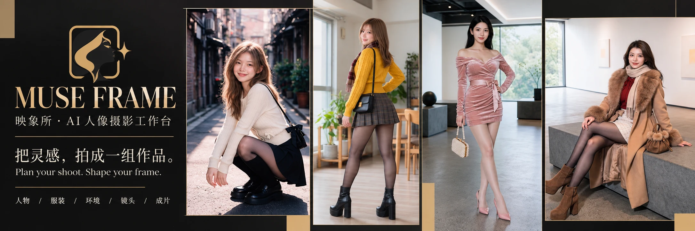
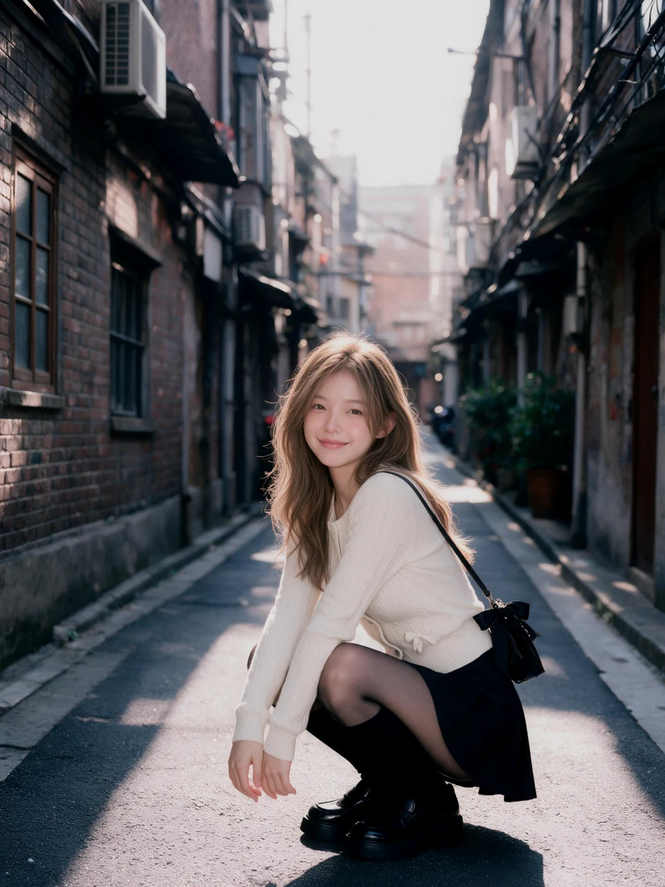
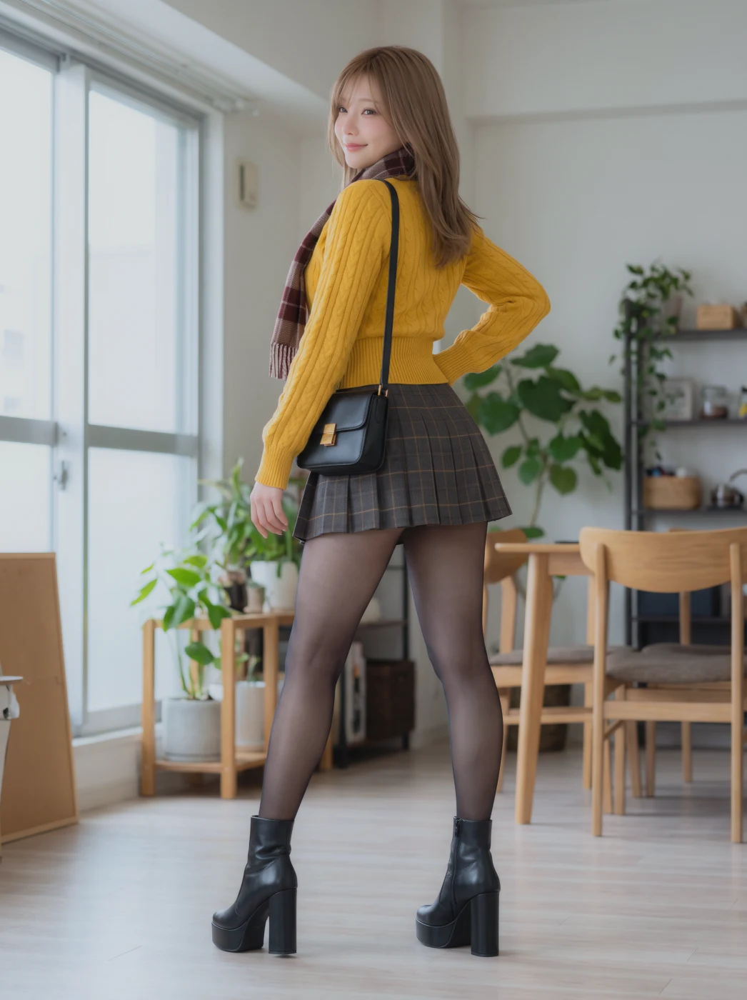
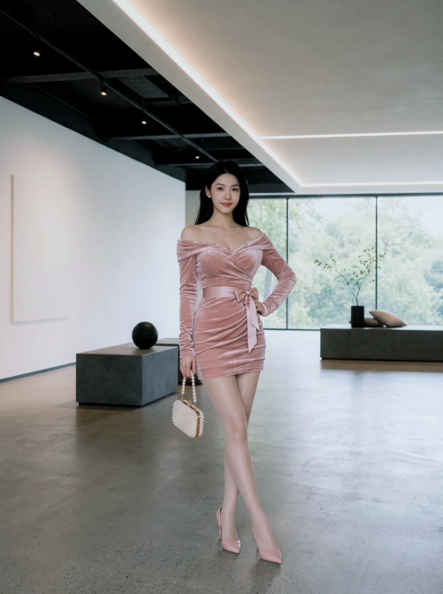
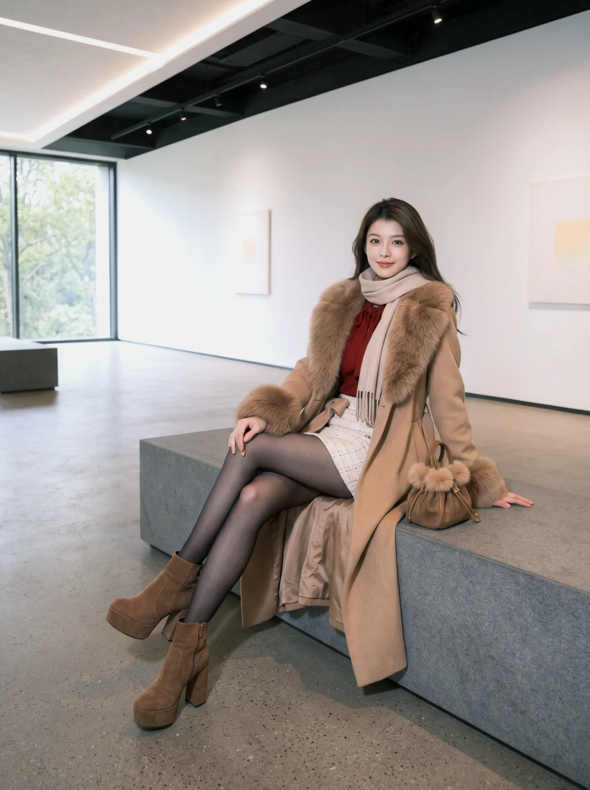

# 映象所 · MUSE FRAME

**把灵感，拍成一组作品。**

映象所是一款以本地项目为中心的 AI 人像摄影工作台。从整理参考、设计造型、规划镜头，到生图、选片、修改和导出，把一次创作组织成完整的拍摄流程。通过你自己的 Lovart 或 LibTV 账号生成，项目与下载的图片保存在电脑上。

**[下载 Mac 版](https://github.com/KaneGong/muse-frame/releases/tag/v0.4.0-beta.2) · [完整使用教程](docs/zh-CN/user-guide.md) · [本地 WebUI](docs/zh-CN/quick-start.md#本地webui源码版) · [English](README.md)**

社区预览 **0.4.0-beta.2** · **AGPL-3.0-only** · 当前安装包：**macOS 26+、Apple Silicon** · 临时签名，**未 Apple 公证**。Windows 与 Intel Mac 安装包尚未提供。

*截图来自真实 macOS App，使用独立演示项目和维护者提供的既有 AI 作品。演示环境有意保持未连接，截图不代表新执行了一次生图。*

## 从参考到成片，按一次拍摄来创作

适合 AI 人像创作者、希望探索视觉方案的摄影师，以及需要本地工作流和开放源码的开发者。

| 步骤 | 可以做什么 |
| --- | --- |
| **准备素材** | 新建项目，分别安排人物面部、身形、服装、环境和姿态参考。 |
| **确定影调** | 选择摄影风格，再微调光线、色调、反差与景深。 |
| **规划镜头** | 为每个镜头设置姿态、景别、画面位置和人物占比；可添加镜头或套用模板。 |
| **提交生成** | 在右侧常驻栏核对最终提示词与参考顺序，通过自己的平台账号提交。 |
| **选片与完善** | 放大查看、文字修改、本地调色，最后下载原图或打包。 |

### 每种参考，各司其职

人物与身形、服装、环境、姿态分别承担不同作用。在线图库先放大看图，再复选导入，**每次最多 10 张**；导入后由你决定本次拍摄使用哪一张，不会自动替换当前选择。

### 镜头数和每镜头张数，分开控制

成组模式按已配置的镜头清单生成，单张模式只使用当前镜头。右侧的张数是**每个镜头生成几张**：**3 个镜头 × 每镜头 4 张 = 共请求 12 张**。第一次建议从 1 个镜头、1 张图片开始核对效果，实际能力和限制以平台为准。

### 预设是起点，也能继续微调

摄影风格提供基础设定，展开“风格微调”后，可以单独覆盖某一项、继续“随风格”，或移除该项要求。右侧提示词会帮助你检查最终提交的内容。

### 保留原版，再修改和整理

用复选框选片，下载所选原图或打包本机图片；次要功能收进“更多操作”。文字修改会创建新任务并保留原版，本地基础调色无需新提交生图任务。普通删除先进入回收站，可以恢复。

## 作品选集

从维护者整理的作品中选取四组：街巷、自然光室内、极简空间与冬日造型。它们展示既有创作，不代表每次生成的保证效果或模型一致性测试。

| 街巷人像 | 室内自然光 | 极简空间 | 冬日造型 |
| --- | --- | --- | --- |
|  |  |  |  |

[查看大图与更多 App 截图 →](docs/showcase.md)

## 开始第一次拍摄

1. 在 [Releases](https://github.com/KaneGong/muse-frame/releases/tag/v0.4.0-beta.2) 下载 DMG，将 App 拖到“应用程序”再打开。当前版本未公证；如被系统拦截，请阅读 [Apple 官方说明](https://support.apple.com/zh-cn/102445)。
2. 在“连接与设置”选择 Lovart 或 LibTV，自行完成授权，再挑选要使用的模型。
3. 新建项目并选好参考，确定环境与风格，先配置一个镜头。
4. 在右侧核对模型、支持的画幅和分辨率、提示词、参考顺序与总张数，确认后提交；生成使用你的平台额度。
5. 放大选片并保存原图，再尝试增加镜头或使用文字修改。

**[图文教程：安装 → 参考 → 镜头 → 生成 → 修改 → 导出](docs/zh-CN/user-guide.md)**

## 选择使用方式

| | Mac App | 源码 WebUI |
| --- | --- | --- |
| 适合 | 直接打开桌面工作台 | 本地浏览器使用、开发和扩展 |
| 当前要求 | macOS 26+、Apple Silicon arm64 | Python 3.11+ 和依赖；本轮验证 Python 3.14，开发检查使用 Node.js 22。 |
| 安装 | [下载 DMG](https://github.com/KaneGong/muse-frame/releases/tag/v0.4.0-beta.2)，已内置 Python | [源码启动教程](docs/zh-CN/quick-start.md#本地webui源码版) |
| 状态 | 临时签名、未公证；其他系统版本和设备仍需继续测试 | 单用户本机服务，尚非托管的多人网站 |

生图需要可访问的 Lovart 或 LibTV 账号及可用额度。本轮社区预览不收工作台订阅费，不赠送生图额度。工作台不训练、不内置生图模型，与两家平台无官方隶属关系。

## 隐私与预览版边界

项目和已下载图片存储在本机；**提交任务时，提示词与选中的参考图会发送至绘图平台**。在线图库会访问其来源网站。详见[隐私说明](docs/zh-CN/privacy.md)。

模型目录、可用参数、费用和生成规则可能变化；连接成功不等于所有模型组合都已实测。身份、姿态、人物占比属于模型理解的生成要求，不能保证精确几何结果。支持中英文界面，但部分诊断、内置提示词和上游图库文字仍为中文。当前不提供涂抹蒙版编辑、外部识图模型反推提示词。详见[兼容性与已知限制](docs/zh-CN/compatibility.md)。

## 一起把下一版做好

欢迎先试一组小规模拍摄，通过 [Issues](https://github.com/KaneGong/muse-frame/issues/new/choose) 提交可复现问题或使用建议。请附版本、系统与芯片、步骤、平台与模型；公开报告前去除私人内容和账号凭据。

[贡献指南](CONTRIBUTING.md) · [构建说明](docs/zh-CN/build.md) · [更新记录](CHANGELOG.md) · [安全反馈](SECURITY.md)

## 开源与致谢

软件采用 **[AGPL-3.0-only](LICENSE)**，可以按协议条件商用。每个发布标签保留对应源码，DMG 也包含对应源码包；再分发或修改时须保留源码提供方式，并遵守适用的网络服务源码义务。

作品展示经过维护者授权，不会自动纳入 AGPL。仓库不包含第三方图库原图或用户项目。请分别阅读[素材来源](ASSET_LICENSES.md)、[依赖许可](THIRD_PARTY_NOTICES.md)和[品牌说明](TRADEMARKS.md)。
