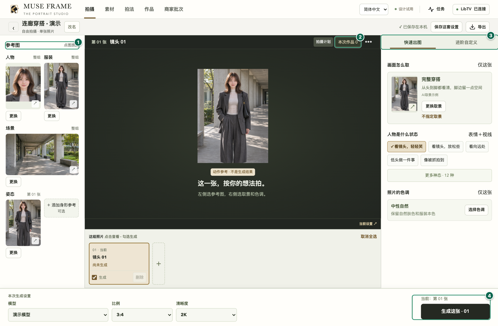

# 映象所 · MUSE FRAME

映象所是一个适用于 Mac 和 Windows 的本地 AI 人像摄影工作台。选好人物、服装、场景和姿态，配好取景和色调，就能准备第一张照片。需要细调时，可按镜头调整光影、身形参考和拍摄要求。作品、项目和任务记录保存在电脑上，确认提交时才会把所选参考图和提示词发送至你连接的 Lovart 或 LibTV 账号。

**[下载 0.5.0-beta.5](https://github.com/KaneGong/muse-frame/releases/tag/v0.5.0-beta.5) · [第一次拍摄图文教程](docs/zh-CN/webui-guide.md) · [安装与迁移](docs/zh-CN/quick-start.md) · [发布说明](RELEASE_NOTES.md) · [English](README.md)**

## 社区预发布版 0.5.0-beta.5

Mac 和 Windows 启动器会在系统默认浏览器中打开同一套界面，安装包已包含启动所需组件。工作台服务在本机运行，只监听本地回环地址。

| 使用方式 | 安装包与验证状态 |
| --- | --- |
| Mac | Apple 芯片 DMG。App 采用临时签名，尚未经过 Apple 公证。最低系统版本见 DMG 内的 `BUILD-INFO.txt`。 |
| Windows | 面向当前 Windows 用户的 x64 安装程序。安装程序和启动器均未签名。[Windows x64 自动检查](https://github.com/KaneGong/muse-frame/actions/runs/43157259382/job/130979965361)已通过。 |
| 源码 | 安装 Python 后，可从源码目录启动同一套本地 WebUI。[源码启动说明](docs/zh-CN/quick-start.md#本地-webui-源码版) |

此前的 [0.4.0-beta.2 Mac 版](https://github.com/KaneGong/muse-frame/releases/tag/v0.4.0-beta.2) 仍可下载。该版使用内嵌窗口，[图文教程](docs/zh-CN/user-guide.md)对应旧版界面。

## 从参考图到作品

- 新建拍摄，为人物、服装、场景和姿态分配各自的参考图。需要单独设置身形时，可在进阶选项中添加。
- 选择拍法，也可以单独调整镜头的取景、人物位置、神态、色调和光线。浏览人物、服装、姿态图库并选择本次要用的图片。
- 在设置里自行连接平台。在生成确认页核对所选模型、实际提示词和参考图，再决定是否提交。
- 打开作品查看可用原图，下载、做本地调色，或通过新任务提交文字修改。

[按步骤完成第一次拍摄](docs/zh-CN/webui-guide.md) · [作品选集和旧版 Mac App 截图](docs/showcase.md)

## 升级与接续旧工作区

等任务结束后，从**拍摄列表 → 工作区迁移与备份 → 退出本机工作台**退出在用版本，再打开新版。如果旧版仍在运行，新版会显示两个版本号，并提供打开在用工作区的入口。

在**工作区迁移与备份**中，可以检查旧工作区、将支持的数据复制到独立工作区、备份到文件夹，或切回上一份工作区。保留旧程序和旧资料。新版需要平台授权时，由你自行连接。[安装、迁移和回退](docs/zh-CN/quick-start.md)。

## 隐私、反馈与许可

在线图库会访问各自的来源站点。平台可用性、模型参数与费用由平台决定。本预发布版提供简体中文与英文界面，部分平台诊断、内置提示词和图库文字仍采用来源语言。[隐私](docs/zh-CN/privacy.md) · [兼容性](docs/zh-CN/compatibility.md)。

反馈可复现问题时，请附映象所版本、操作系统、芯片架构及步骤。公开前移除私人图片、提示词和账号凭据。[问题反馈](https://github.com/KaneGong/muse-frame/issues/new/choose) · [构建](docs/zh-CN/build.md) · [更新记录](CHANGELOG.zh-CN.md) · [安全反馈](SECURITY.md)。

软件采用 [AGPL-3.0-only](LICENSE)。0.5.0-beta.5 对应的源码归档、文件清单和 SHA-256 校验文件与安装包分别提供。展示作品和示例素材适用各自的使用条款。[素材说明](ASSET_LICENSES.md) · [依赖许可](THIRD_PARTY_NOTICES.md) · [品牌说明](TRADEMARKS.md)。
