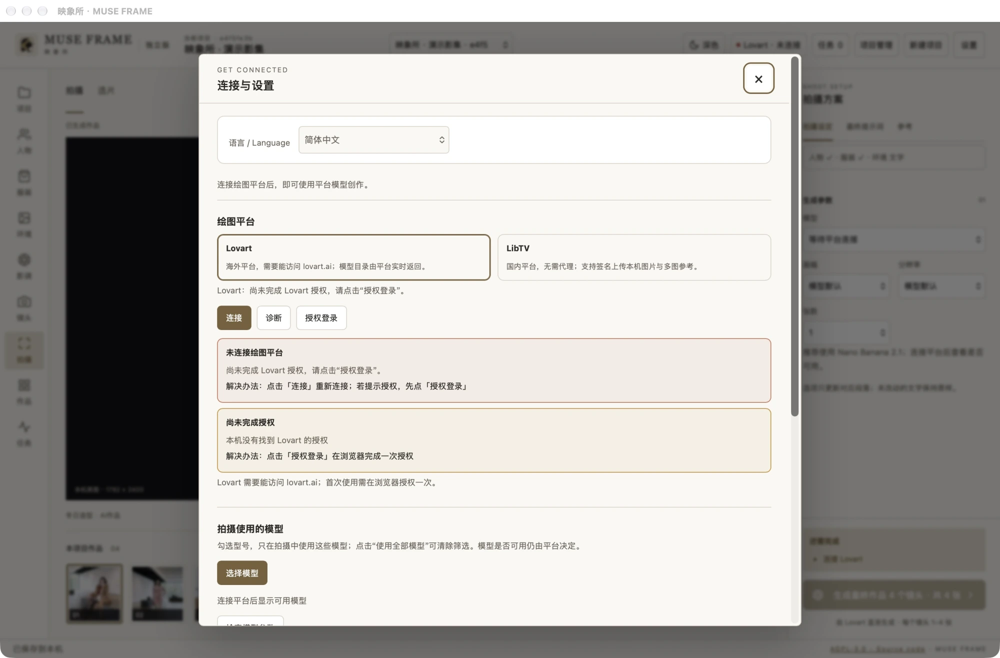
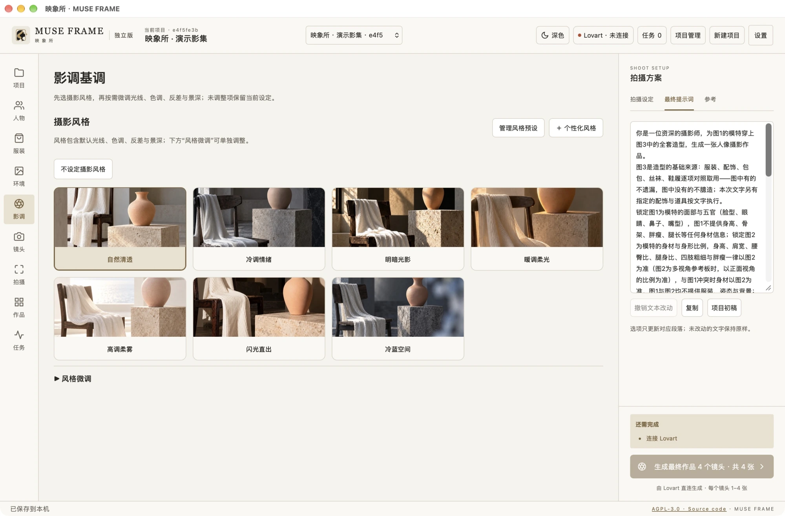
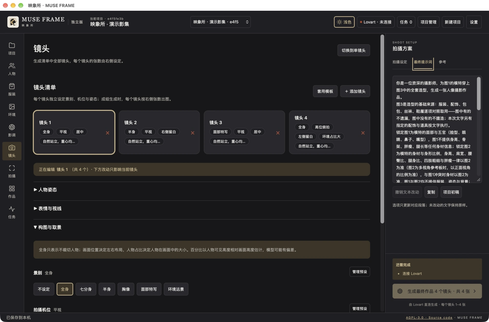
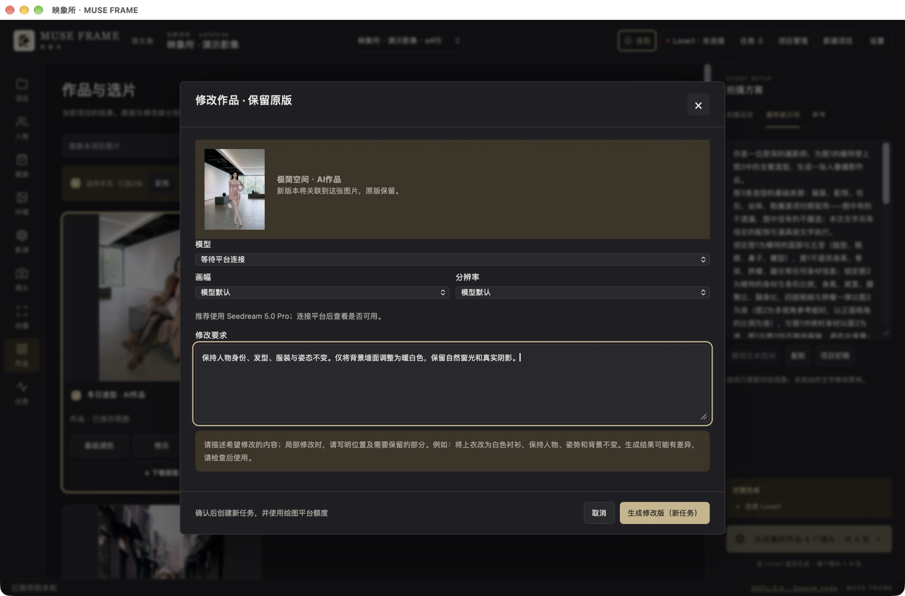

# MUSE FRAME user guide

[Product page](../../README.md) · [简体中文](../zh-CN/user-guide.md) · [Gallery and screenshots](../showcase.md)

For community preview 0.4.0-beta.2. Screenshots show the actual Mac App with an isolated demo project and previously generated AI works authorized by the maintainer. No account authorization was copied and no new generation was submitted for these screenshots. The disconnected status is intentional.

## 1. Install and open

The downloadable App requires **macOS 26+, Apple Silicon (M-series)**. Windows and Intel Mac binaries are not available yet. Release checks ran on macOS 27.0.1 / arm64; other versions and clean devices still need more testing.

Download the DMG from the [official Release](https://github.com/KaneGong/muse-frame/releases/tag/v0.4.0-beta.2), open it, copy the App to Applications and launch that copy. Do not replace it while saving or generating. The preview is ad-hoc signed and not Apple-notarized. If macOS blocks it, read [Apple's guidance](https://support.apple.com/en-us/102445) and decide whether to trust the source. There is no need to disable Gatekeeper globally.

For a browser workspace, follow the [source WebUI setup](quick-start.md#source-browser-ui). This is a local single-user service, bound to the loopback address.

## 2. Connect your image platform

Open the platform status button or Settings:

1. Choose Lovart or LibTV. You need your own account, available credits and network access to that provider.
2. Choose authorization/login and complete the browser flow yourself, then return and connect. Do not share passwords, cookies or tokens.
3. Review the returned model catalog. Use model selection to keep preferred models; clear the filter to use all available models.
4. Select a model in the generation controls and check its advertised aspect ratios and resolution options. Recheck after changing models.

The provider controls model availability and parameters. An unadvertised parameter cannot be assumed to work. A successful connection is not a generation test of every model. If parameters are empty or rejected, reconnect to refresh the catalog and check provider support before submitting paid tasks.

Language is also selected here. Switching languages preserves user-written content. Some diagnostics, built-in generation prompts and upstream gallery labels remain Chinese.

## 3. Create a project and arrange references

Choose New project and name the shoot. Use the top project selector to switch projects and Project management to organize them. Each project retains its own references, shots and works.

| Reference | Purpose | Practical guidance |
| --- | --- | --- |
| Face | Facial identity, features and hair | Use a clear, consistent identity. |
| Body | Proportions and build | Reuse the person reference or choose a body reference of the same identity; avoid accidental identity mixing. |
| Outfit | Clothing, accessories and styling | Choose the outfit for this shoot; importing several does not apply all of them. |
| Environment | Location and spatial structure | Describe it in text and optionally choose a reference image. |
| Pose | Body action and posture | Configure it for the shot and check the submitted reference order. |

Upload your images or browse the online face, outfit and pose libraries. Open a large preview, then select images to import, up to **10 per import**. Downloads are processed individually; follow the UI for failed or remaining selections. **Importing only adds a reference: choose explicitly which image/outfit to use for this shoot.** Read the library's source notes and conditions.

Review the actual images and order in the right-hand References tab. The example below reuses one AI photo for face, body and outfit roles to illustrate the workflow.

## 4. Set the environment and photographic look

Describe the location, light sources, layout and space for standing or seated poses. Optionally generate an environment reference board through the environment workflow, then select it for the shoot. A reference board and a final portrait serve different purposes.

Choose a photography preset in Look, then expand Style adjustments:

- **Follow style**: inherit that setting from the current style.
- **Choose an individual option**: override just that setting, such as light, color, contrast or depth of field.
- **Unset**: remove that requirement.

Presets and individual adjustments work together. Check the final prompt in the right panel after changes. Language switching does not translate your handwritten text.

For person, outfit, pose and environment reference generation, and final portraits, Nano Banana 2.1 is the suggested starting point when available from your provider. Other models can be tried. This is a workflow suggestion, not a guarantee of better results.

## 5. Plan each shot

Open Shots and add a shot or apply a template. Each shot has its own pose, expression/gaze, composition, framing and lens choices. **Select the shot card before editing the controls below it**; the page identifies the active shot. Read the replace/keep choices when applying templates.

Framing, screen position and subject size are separate controls. For a small figure within a large environment, combine Environmental long shot with More environment, then choose centered or side space independently. Older projects can reselect the legacy subject-size option to update its description; saved text is not silently rewritten.

These are prompt instructions, not precise geometric controls. If a subject remains too large, check the final prompt for conflicting half-body, close-up or handwritten requirements before changing models or references.

## 6. Understand shots versus image count

| Mode | What is submitted | Example |
| --- | --- | --- |
| Single | Current shot only | 4 images per shot → 4 images requested |
| Group | Configured shot list | 3 shots × 4 images per shot → 12 images requested |

The image count means **how many images to request from one shot and one setup**. It does not add shot configurations. Shots submit separately; provider concurrency, output-count and credit limits still apply. Check the total on the generation button and actual task results. Requested count is not a guarantee of successful outputs.

Start with **1 shot × 1 image**. Choose the model's supported aspect ratio and resolution, and recheck after switching providers/models. Do not invent values for unknown parameters.

## 7. Review and submit

In the persistent right panel, review:

1. Shoot settings: provider, model, ratio, resolution, per-shot count and total.
2. Final prompt: the actual text being submitted, including possible conflicts with older settings.
3. References: correct identity, outfit, environment, pose and order.

Submit when ready. The prompt and selected references are sent to the provider and **consume your platform credits**. Installing or opening the App does not automatically start paid generation.

Use Tasks and progress to see real stages, results and errors. A slow task is not necessarily failed. If submission status is uncertain, check the provider record and recover the existing task rather than paying twice. Retrying a confirmed failure with its parameters creates a new task and retains the old failure record. Closing the App stops the local service, but a provider task may continue; check recovery after reopening.

## 8. Select, inspect and download

Shoot offers a large preview and image strip. Works and selection is for organizing the set.

- Click an image to enlarge it. Preview and original are different resources; follow the UI to download or await the original if it is not local yet.
- Use card checkboxes. Select this page affects only the current page; Clear selection removes the selection.
- Download selected originals retrieves originals; Package local images uses files already on your computer. Check which files are local.
- A card's Download original and provider-original entry let you save or inspect its source.
- More actions exposes applicable operations such as rename, regenerate and save as a pose card; available actions depend on the image.
- Ordinary deletion moves a work to Trash, where it can be recovered. Permanent deletion needs a deliberate decision.

The Mac App opens a system save dialog for downloads/exports; the browser version follows browser download settings. Distinguish original-size metadata from the dimensions of the displayed preview resource.

## 9. Modify a work with text

Choose Modify on a work. Check the source image, then describe **what to change and what to preserve**. For example:

> Keep the person's identity, hairstyle, outfit and pose unchanged. Change only the background wall to warm white, retaining natural window light and realistic shadows.

Select a model that supports image editing and its parameters. Submitting uses credits to create a new version; the original is retained. This version has no brush/mask editor, and the model may change unrequested details, so review the result. Seedream 5.0 Pro is the suggested starting point when available; other models can be tried, subject to provider support.

## 10. Local color, backups and updates

Basic color adjustment works locally and does not submit a provider generation task. Apply a preset, fine-tune and confirm the adjustment. Keep originals for comparison and recovery.

The Mac App uses `~/Library/Application Support/AI Portrait Studio Standalone`; source WebUI uses its own `data/` directory. They are separate. The legacy data identity is retained to preserve existing projects.

Save and quit before backing up the full data directory or replacing the App. The directory contains platform authorization: keep it securely on your computer and do not upload it to GitHub. Removing the App alone does not delete project data. Project exports may contain works and references; review them before public sharing.

## Troubleshooting

| Symptom | Check first |
| --- | --- |
| No models or parameters | Current provider authorization, model filters, refreshed catalog and the model's advertised support. |
| Fewer results than requested | Actual task/provider records: pending, failed, moderated and partially returned are different states. Do not immediately resubmit the entire batch. |
| Blurry preview | Whether you are viewing a thumbnail or local original, whether download completed, and actual dimensions at zoom. |
| Subject still too large | Environmental long shot, conflicting close-up/half-body text and custom instructions. Models do not guarantee exact proportions. |
| Library import fails | Source-host network/conditions; keep selections and follow the UI to continue failed/remaining imports. |
| Chinese text in English UI | Some diagnostics, built-in generation text, upstream labels and user content are not automatically translated. |
| Projects missing after update | Whether you launched a different source/App data directory. Locate the old data before replacing anything. |

[Compatibility and known limits](compatibility.md) · [Privacy](privacy.md) · [Report an issue](https://github.com/KaneGong/muse-frame/issues/new/choose)
