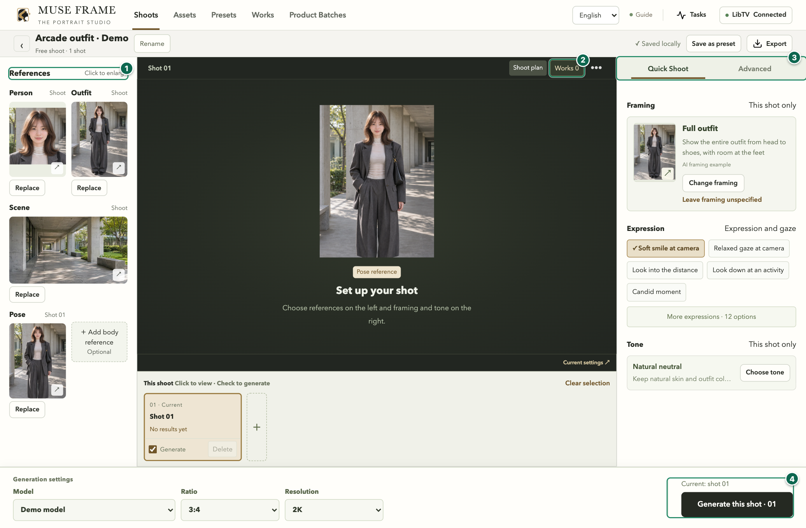
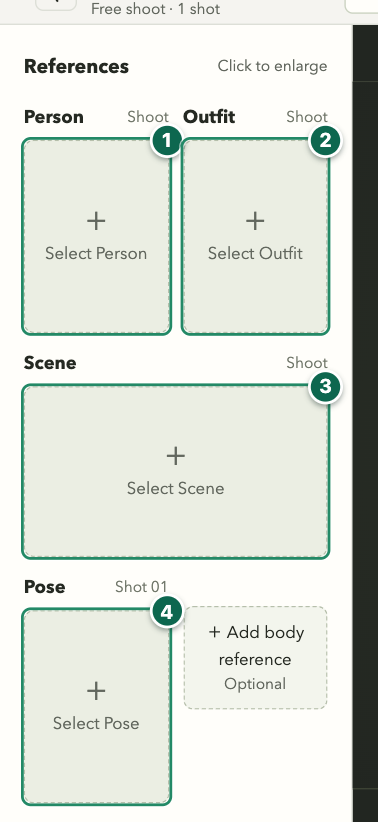
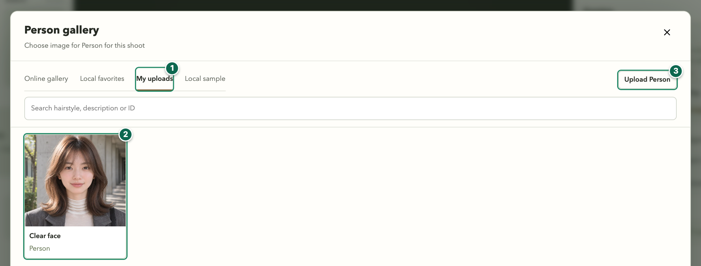
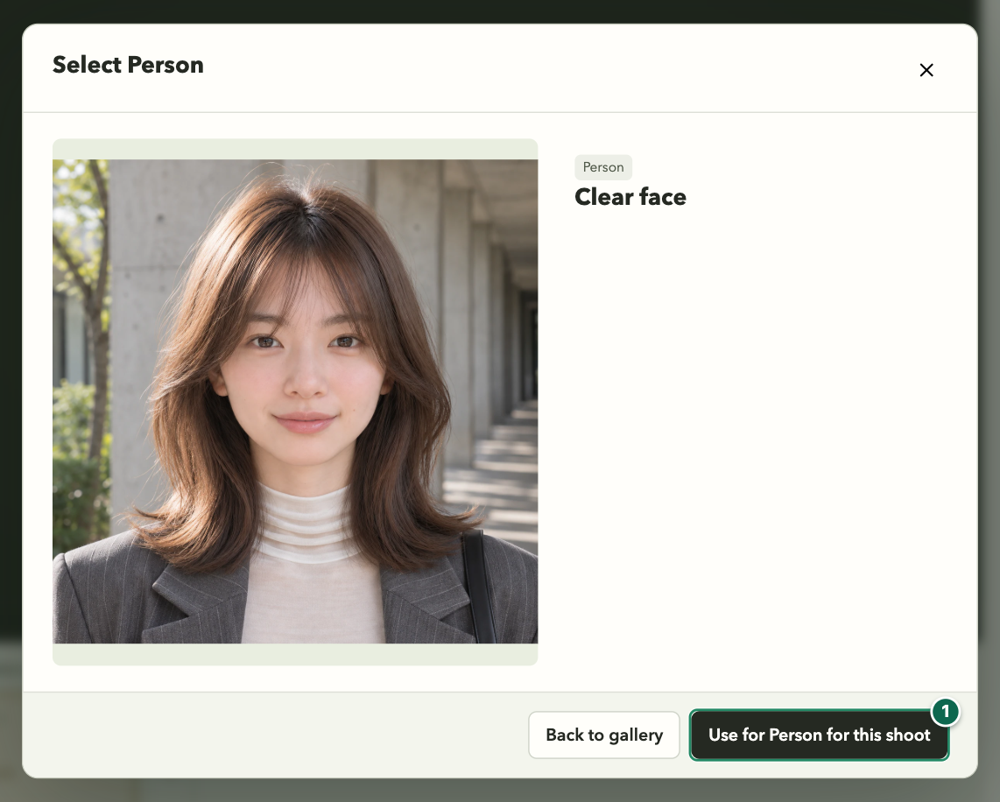
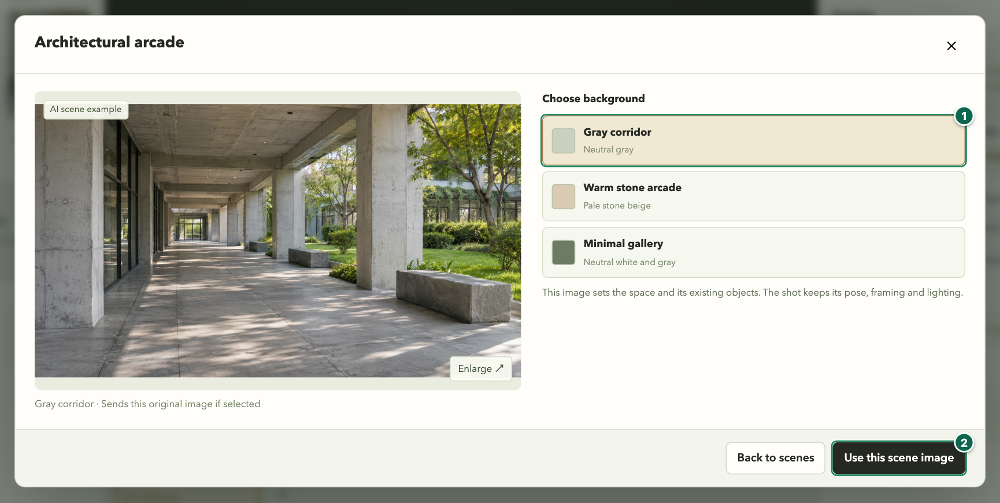
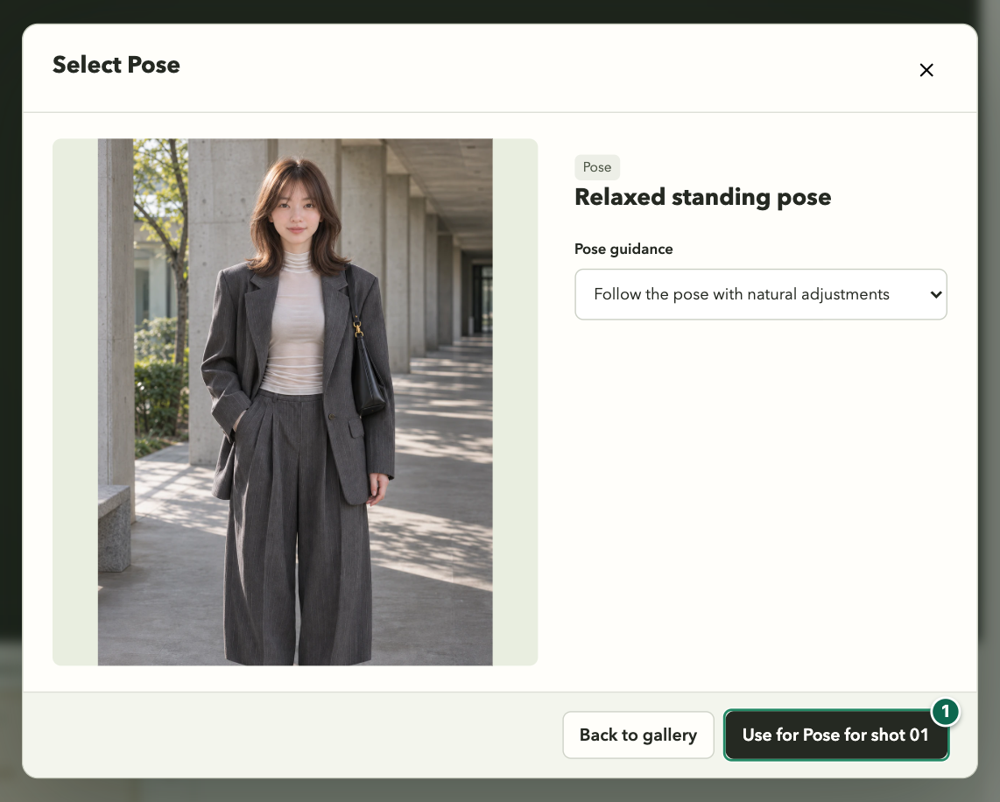
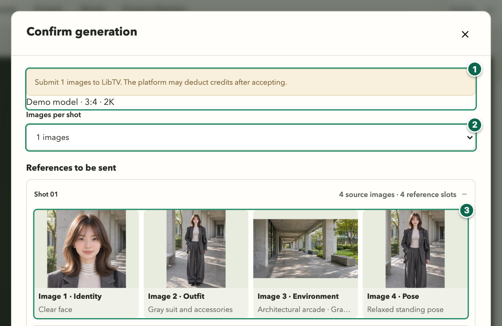
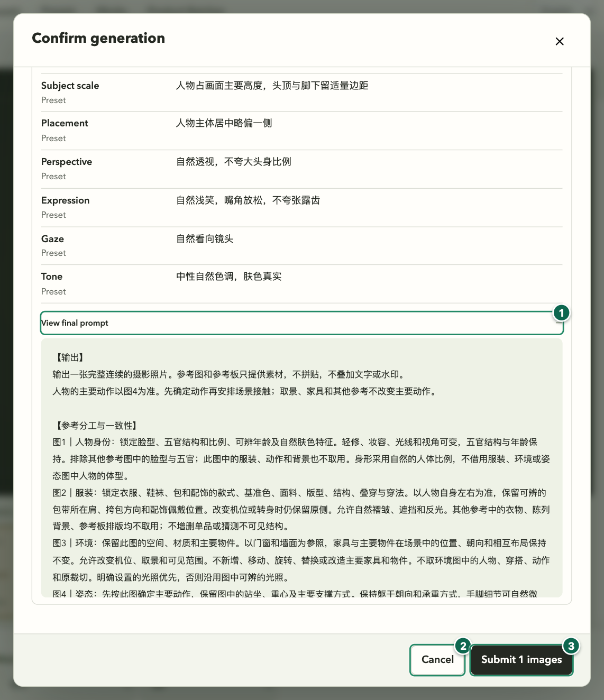
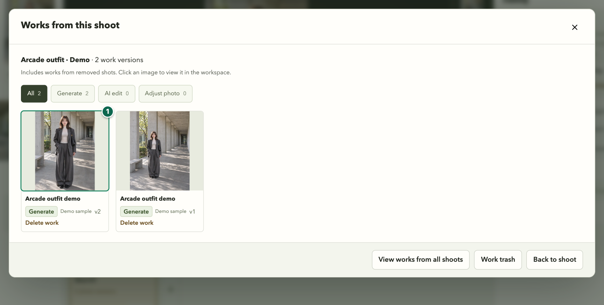
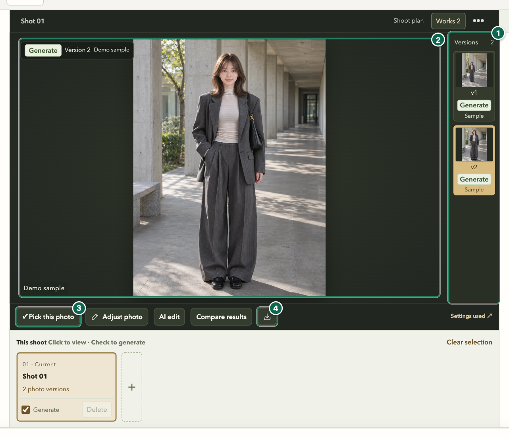

# Muse Frame WebUI guide

For 0.5.0-beta.5. Walk through one outfit photo for social media, from selecting four references to downloading the original.

[Download for Mac or Windows](https://github.com/KaneGong/muse-frame/releases/tag/v0.5.0-beta.5) · [Install, migrate and roll back](quick-start.md) · [简体中文](../zh-CN/webui-guide.md)

The screenshots use an isolated demo workspace. The model and works are examples. No generation task was sent to a provider. The prompt body can retain its original language.

## 1. Open the workspace

- **Apple Silicon Mac** Open the DMG, drag Muse Frame into Applications, then open the app.
- **Windows x64** Run Setup. After installation, open Muse Frame from Start.
- Muse Frame opens in your default browser. Use the language menu in the upper right to switch between English and Simplified Chinese. Select **Shoots** to return to your list. Continue an existing shoot or choose **Free shoot** to start with one shot.

### The three panels and the generation bar

1. Use References on the left to choose a person, outfit, scene and pose.
2. Shoot plan in the middle shows the current shot. Works opens its results.
3. Choose Quick Shoot on the right. This example uses Full outfit, Soft smile at camera and Natural neutral.
4. Choose the model, aspect ratio and resolution at the bottom. Click Generate this shot to open the review.

## 2. Choose four references

The references on the left have separate roles. For this example, use a clear face, a complete outfit, an indoor scene and a standing pose.

| Reference | What to choose | What the model should take from it |
| --- | --- | --- |
| Person | A clear view of the face | Identity and facial features |
| Outfit | A view of the entire outfit, including shoes and accessories | Cut, colors, layering and accessories |
| Scene | An indoor scene with a specific background selected | Space, existing objects and layout |
| Pose | A standing pose and a suitable viewing angle | Body orientation, stance and points of contact in this shot |

Choose the person, outfit and pose from the online galleries or upload your own images. Filter the person gallery by category. Use the angle controls within a pose card to select a view. Click a selected reference to enlarge it. Person, outfit and scene apply across the shoot. Set pose for each shot.

### What to choose in each slot

1. Click Select Person and choose a clear view of the face.
2. Click Select Outfit and choose an image that shows the clothes, shoes and accessories.
3. Click Select Scene and choose a space with a clear layout and visible objects.
4. Click Select Pose and choose a standing pose for Shot 01. You can leave body reference empty.

### Open the person gallery and choose a photo

1. Use My uploads to see your own images, or choose from the online gallery.
2. Click the image you want to open its preview.
3. Choose Upload Person to add a file from your computer. The outfit gallery follows the same pattern.

### Check the face and apply it to the shoot

1. Click Use for Person for this shoot. Back on the left, repeat for the outfit and apply it to this shoot.

### Pick a specific background

1. In Select Scene, open Architectural arcade and choose Gray corridor. You can also upload a background from the scene list.
2. Click Use this scene image. When it appears in the left panel, it applies to the shoot.

### Apply the pose to this shot

1. Click Use for Pose for shot 01. This example uses a standing pose from My uploads. For an online pose with several angles, choose the view before applying it.

## 3. Set up the shot

Use **Quick Shoot** on the right. Under **Framing**, select **Full outfit**. Under **Expression**, choose **Soft smile at camera**. Under **Tone**, choose **Natural neutral**. Aim for a standing, head-to-toe photo with a gentle expression and natural colors.

For a recommended shoot plan, go to **Shoots → New shoot**. Switch to **Advanced** for lighting, an optional body reference or individual shot settings. A setting can offer options to inherit the shoot setting, use a preset, enter a custom value or omit it. For this first image, start with four references and change one setting at a time after reviewing the result.

## 4. Connect a platform and review the request

1. Open **Generation platform** in the upper right. Choose **Lovart** or **LibTV**, select **Authorize platform**, and finish authorization on the provider's page with your own account.
2. Return to Muse Frame and choose **Connect / refresh**. When the platform shows **Connected**, pick a model at the bottom. Wait for its aspect ratio and resolution options to load. For example, check whether the model offers 3:4 for a vertical social post.
3. Select **Generate this shot** to open **Confirm generation**. Check the platform, model, parameters and quantity. Match the numbered reference thumbnails to their roles in the prompt. Check the five-image list if you added a body reference.
4. Set **Images per shot** to one for this exercise. If an image or instruction is wrong, cancel and revise the shot. Select the submit button only when everything is ready. That sends the selected material to the provider, which may charge credits after accepting the task.

### Check the platform, quantity and references

1. Click Generate this shot, then check the platform, model, aspect ratio and resolution. This example shows 3:4 and 2K.
2. Set Images per shot to one for your first run.
3. Match the thumbnails in order: 1 person, 2 outfit, 3 scene, 4 pose.

### Open the final prompt, then decide whether to submit

1. Scroll down and open View final prompt. Check each reference's role and the shooting settings included in the prompt.
2. Choose Cancel to correct any mismatch, then review again.
3. When everything is ready, select the Submit button for one image. This sends the references and prompt to the provider, which may charge credits after accepting the task.

## 5. Track, pick and save the result

- Open **Tasks** to track submission and results. If a task fails, read the reason. If acceptance is uncertain, check the original provider task before retrying to avoid duplicate requests.
- Review the versions for the current shot or open **Works** for the whole shoot. Enlarge the image to check the face, clothing and accessories, then look at pose, contact points and the setting.
- Use **Pick this photo** for a keeper, and the download control to save the current original. Export can package selected work and a manifest. For a small brightness change, **Adjust photo** edits locally and saves a new version. Use **AI edit** for changes that require another generation, and review the image and edit instructions before sending.

### Open a result from this shoot

1. When a result is ready, click Works above the center panel, then click a thumbnail to open the full view.

### Check the version, enlarge and save the original

1. Use the v1 or v2 thumbnail to the right of the image to select a version.
2. Click the image to enlarge it and inspect the face, outfit and points of contact. Use the wheel to zoom and drag to pan.
3. Choose Pick this photo to mark a keeper.
4. Click the download icon below the photo and choose a folder. Check the selected version before saving its original.

## 6. Back up and update

Open **Shoots → Workspace migration and backup** to inspect an old workspace, make a backup, migrate or switch back. When updating an existing 0.5.0 WebUI installation, finish active tasks and choose **Quit Muse Frame** before replacing the app. The new app reopens the same workspace. To bring over an older desktop workspace, inspect the source files and counts before starting the migration.

[Install, migrate and roll back](quick-start.md#update-migrate-and-roll-back) · [Privacy](privacy.md) · [Compatibility](compatibility.md)
