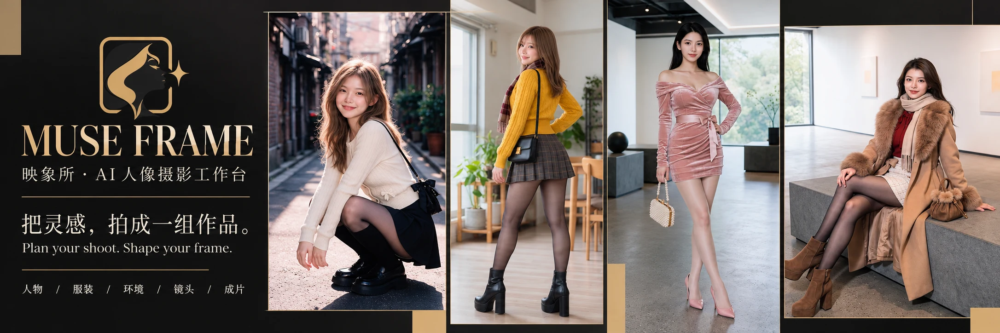
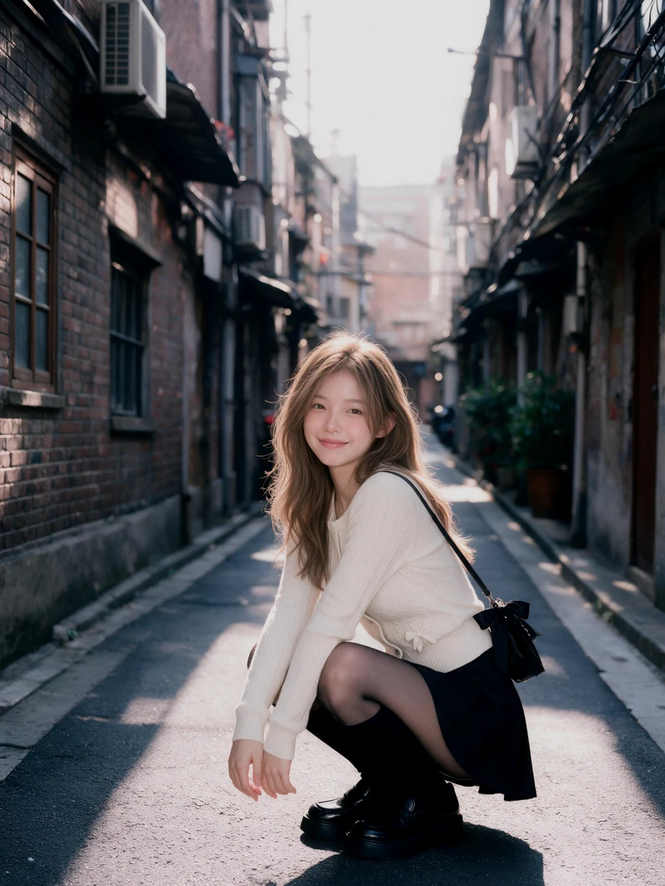
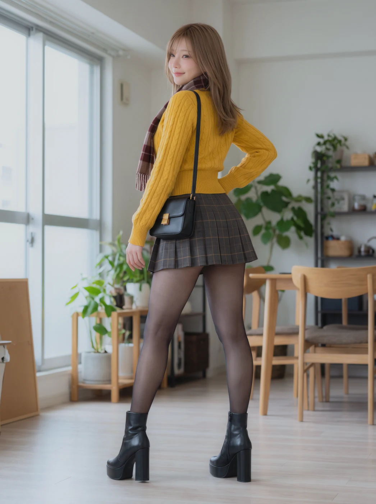
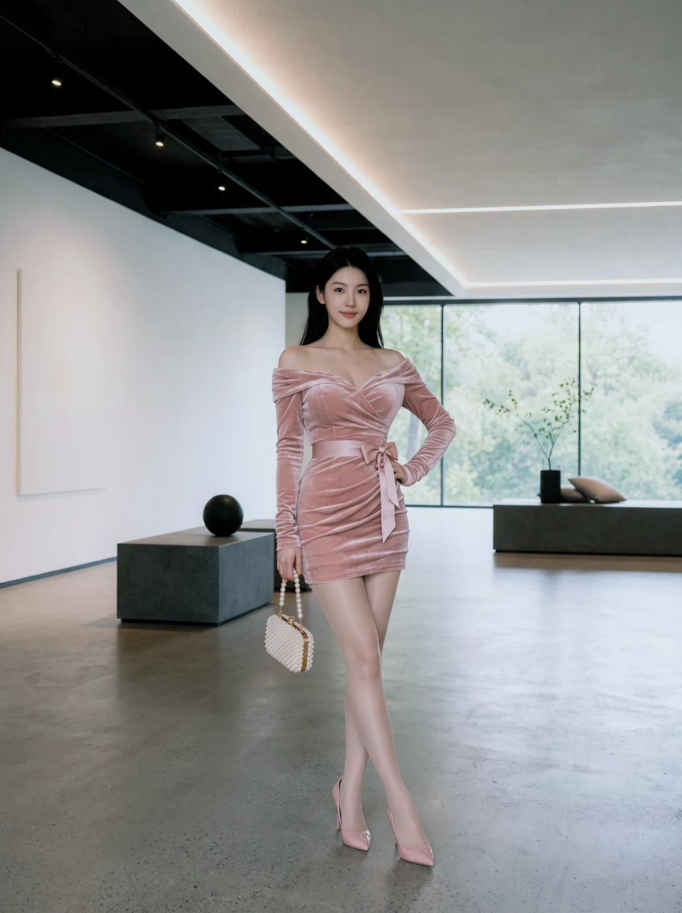
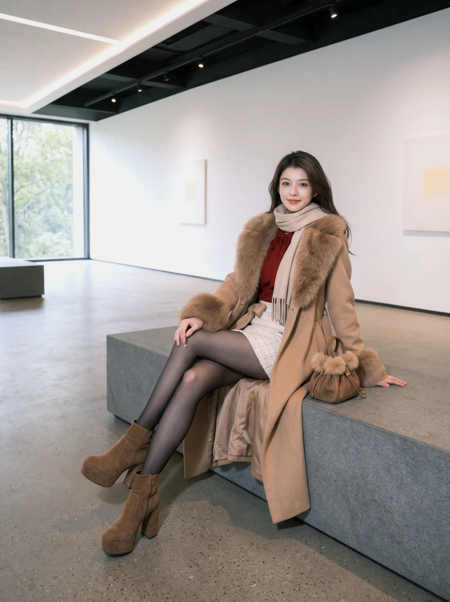
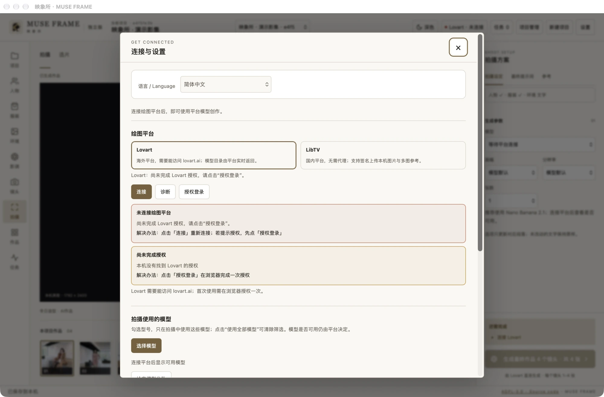
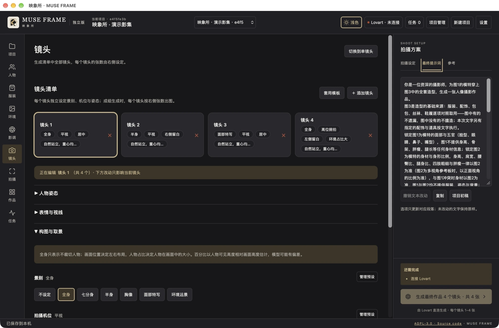
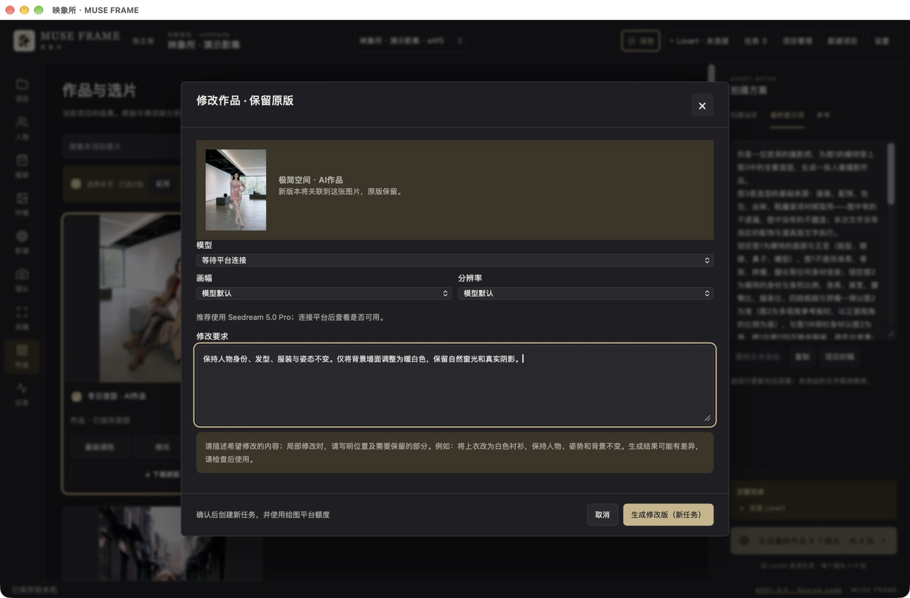
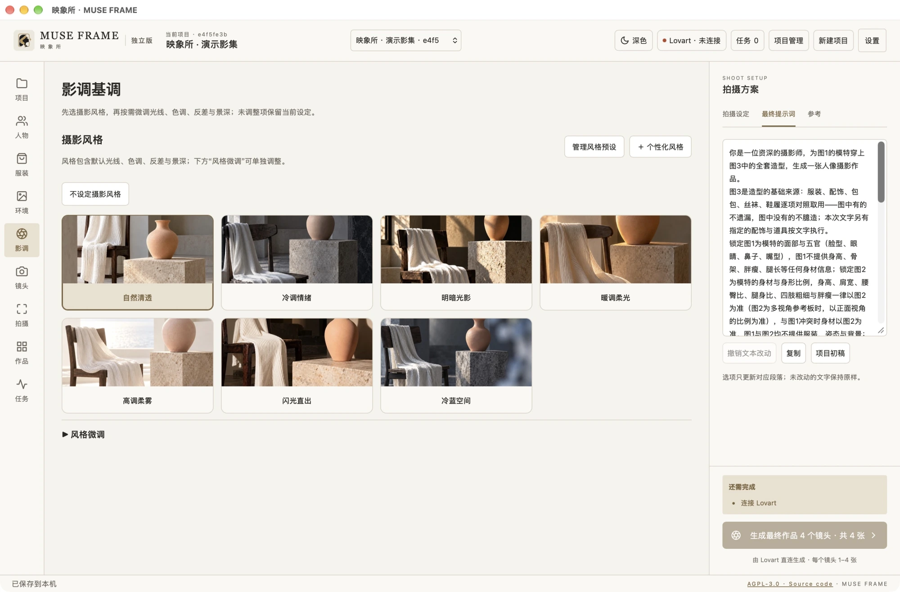

# Portfolio & App gallery · 作品与界面

[English product page](../README.md) · [中文首页](../README.zh-CN.md) · [User guide](en/user-guide.md) · [使用教程](zh-CN/user-guide.md)

## Portfolio cover · 作品集横幅

The banner is an AI-assisted promotional layout based on four supplied works and the approved product mark. The individual examples below are resized/encoded previews of the supplied works, without generative edits.

横幅以四张作品与已选定的产品 Logo 为参考进行 AI 辅助排版。下方单幅展示仅缩放、转码，不做生成式修改。

## Selected works · 作品选集

Previously generated AI works from the maintainer's curated collection, used with permission. These examples are not guaranteed generation results, identity-consistency benchmarks or newly executed tasks.

维护者提供并授权展示的既有 AI 作品，不代表每次生成的保证效果、身份一致性测试或本次新增的生图任务。

### Street / 街巷人像

### Daylight / 室内自然光

### Editorial / 极简空间

### Winter / 冬日造型

## Actual Mac App · 真实应用截图

Captured from the actual 0.4.0-beta.2 Mac App in a separate local demo project populated with the works above. No credentials, private user project, successful task records or connected status were fabricated. The disconnected status is intentional; no new generation was submitted for screenshots. Interface screenshots show Simplified Chinese; English UI is available with the partial-translation limits described in the guide.

使用真实 Mac App 的独立演示项目拍摄，载入上述授权作品。未复制账号凭据或私人项目，未伪造已连接状态和生图成功记录；截图未新增付费生图。当前截图为简体中文界面，英文界面及其部分翻译限制见教程。

### Connection settings / 连接与设置

### Shoot workspace, light theme / 浅色拍摄工作区

### Shot planning, dark theme / 深色镜头规划

### Works and selection / 作品与选片

### Text-guided editing / 文字修改

### Photographic look / 摄影风格

[Asset provenance and rights / 素材来源与权利说明](../ASSET_LICENSES.md)
