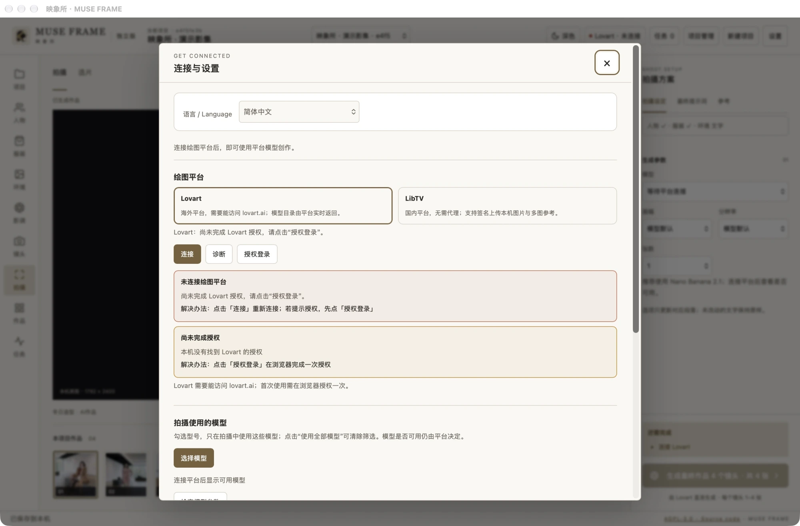
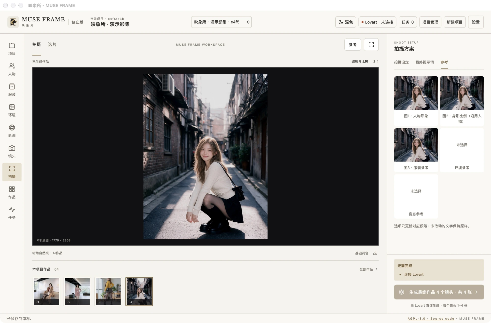
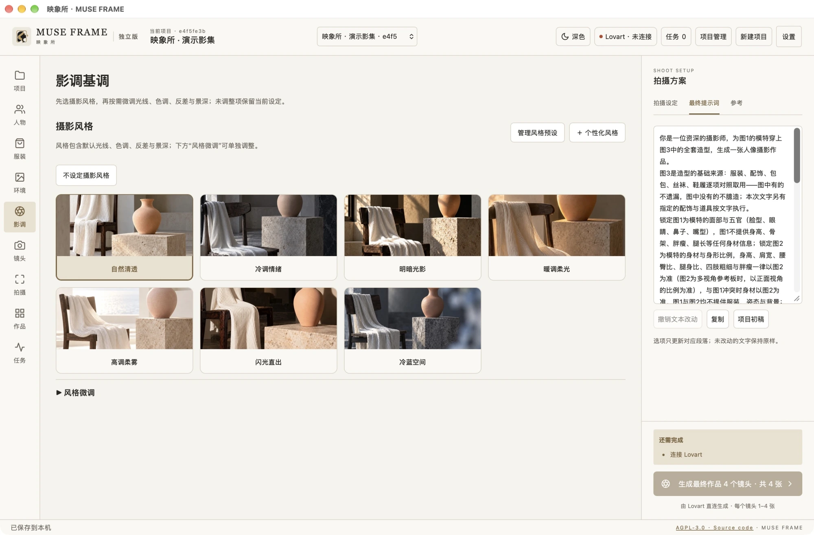
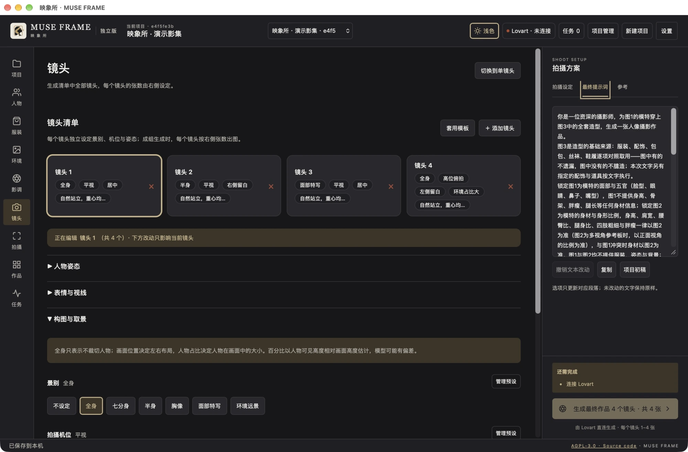
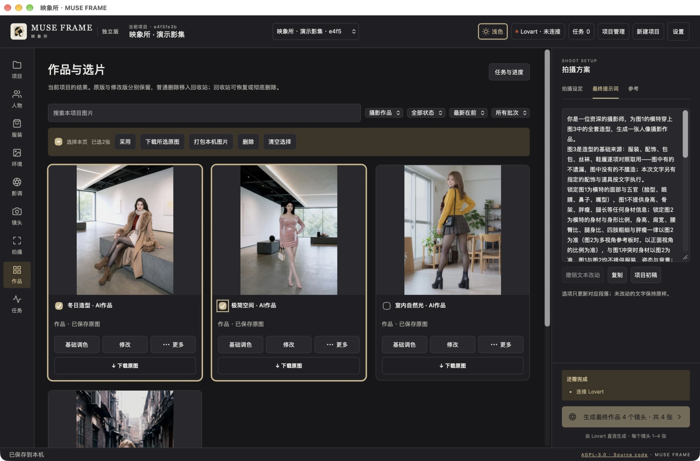
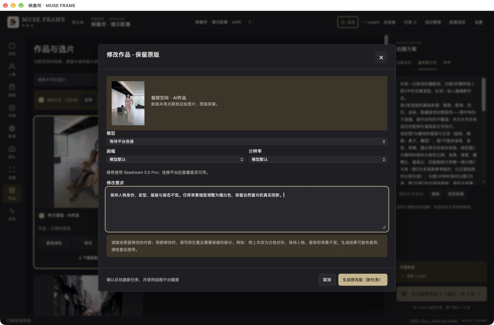

# 映象所使用指南

0.5.0-beta.5 浏览器工作台请看 [WebUI 快速开始](quick-start.md)。本图文教程对应 0.4.0-beta.2。

[返回产品首页](../../README.zh-CN.md) · [English](../en/user-guide.md) · [作品与界面](../showcase.md)

本指南对应 0.4.0-beta.2 社区预览。截图为真实 Mac App，使用独立演示项目和维护者授权的既有 AI 作品，没有复制账号授权，也没有为拍截图新增生图任务。截图的未连接状态是有意保留的。

## 1. 安装与打开

当前 Mac 安装包要求 **macOS 26+、Apple Silicon（M 系列芯片）**，尚未提供 Windows 或 Intel Mac 安装包。实际发布检查环境为 macOS 27.0.1 / arm64；其他符合最低要求的系统和新设备仍需更多验证。

从 [官方 Release](https://github.com/KaneGong/muse-frame/releases/tag/v0.4.0-beta.2) 下载 DMG，打开后将 App 复制到“应用程序”，再从那里启动。不要在 App 正在保存或生成时替换它。当前为临时签名、未 Apple 公证版本；如 macOS 阻止打开，请阅读 [Apple 官方说明](https://support.apple.com/zh-cn/102445)，在确认来源后使用系统提供的打开方式，无需全局关闭 Gatekeeper。

更熟悉代码的用户可以使用[本地 WebUI 启动步骤](https://github.com/KaneGong/muse-frame/blob/v0.4.0-beta.2/docs/zh-CN/quick-start.md#本地webui源码版)。它是电脑上的单用户服务，默认只监听本机地址。

## 2. 连接你自己的绘图平台

点击顶部平台状态或“设置”，进入“连接与设置”：

1. 选择 Lovart 或 LibTV。两者需要各自的账号与可用额度，并且本机能访问所选平台。
2. 点击“授权登录”，由你在浏览器完成授权，再回工作台连接。不要把密码、Cookie 或 Token 发给别人。
3. 连接后查看返回的模型列表，在“选择模型”中筛选常用型号；清除筛选可恢复全部可用模型。
4. 生图时再选择具体模型，检查它返回的画幅与分辨率选项。切换模型后重新确认参数。

模型目录和支持参数来自平台，可能随平台调整；未提供的参数不能假定有效。诊断/连接检查不等于已经实际测试了所有模型。若参数为空或失效，先重新连接并刷新模型目录，再核对平台侧是否支持。不要靠连续重试付费任务来测试连接。

语言选项也在此页。中英文切换保留用户自己写的文字；部分诊断、内置生成提示词及上游图库内容仍为中文。

## 3. 创建项目，安排参考

点击“新建项目”，给本次拍摄起一个容易辨认的名字。顶部项目选择器用于切换项目，项目管理用于整理。每个项目保留自己的参考、镜头和作品。

| 参考 | 主要作用 | 使用建议 |
| --- | --- | --- |
| 人物面部 | 面部身份、五官与发型等 | 用清晰、身份一致的图片。 |
| 身形 | 身高感、骨架与身体比例 | 可复用人物参考，或选同一身份的身形参考；不同人物不要误混。 |
| 服装 | 服装、配饰与整体造型 | 选定本次使用的套装；导入多套不等于一次穿多套。 |
| 环境 | 场所、空间层次与可拍区域 | 可以用文字描述，也可选择环境参考图。 |
| 姿态 | 身体动作与姿势 | 根据镜头配置，并核对最终参考顺序。 |

可上传自己的图片，也可在人物、服装和姿态相关入口浏览在线图库。先点击图片看大图，再复选所需素材，单次最多 10 张。导入按张处理，失败项按界面提示重试。**导入只是加入素材，之后仍需由你选择哪一张或哪一套用于本次拍摄。** 留意图库的来源注解及使用条件。

右侧“参考”页签可核对最终使用的图片和顺序。下图的人物、身形复用和服装来自同一张 AI 演示图，仅用于说明不同参考角色。

## 4. 设定环境和摄影风格

在“环境”描述场所、光线来源、主要布局及人物可站立或坐下的区域。需要时使用环境参考生图流程制作参考板，再手动选择用于拍摄；参考板与最终作品属于不同用途。

在“影调”先选摄影风格，再展开“风格微调”：

- **随风格**：该项沿用当前风格的设定。
- **单独选择**：只覆盖对应的光线、色调、反差或景深等项目。
- **不设定**：移除该项要求。

预设和微调可以配合使用。选完后到右侧“最终提示词”核对实际文字；手写内容不会因为切换语言被自动翻译。

人物、服装、姿态、环境参考生图与最终作品，可优先尝试平台提供的 Nano Banana 2.1；其他模型也可尝试。这是工作台的使用建议，不保证每张结果更好，模型是否可用以平台为准。

## 5. 规划每个镜头

进入“镜头”，点击“添加镜头”或“套用模板”。每个镜头分别设置姿态、表情与视线、构图与取景、镜头观感等内容。**先点中要编辑的镜头卡，再修改下面的选项**；页面会提示当前正在编辑哪个镜头。套用模板前看清界面的替换或保留提示。

景别、画面位置、人物占比是不同维度。想要“小人物、大环境”时，可搭配“环境远景”与“环境占比大”，再独立选择居中或左右留白。旧项目可重新选择一次旧版占比选项以更新描述，不会自动重写你保存的原文。

这些是提示词指令，不能保证模型精确遵守百分比。若结果仍然人物太大，先核对最终提示词是否仍有半身、特写或相互矛盾的自定义描述，再考虑调整模型或参考。

## 6. 区分镜头数和张数

| 模式 | 提交内容 | 示例 |
| --- | --- | --- |
| 单张模式 | 当前一个镜头 | 每镜头 4 张 → 共请求 4 张 |
| 成组模式 | 已配置的镜头清单 | 3 个镜头、每镜头 4 张 → 共请求 12 张 |

右侧“张数”表示**同一镜头、同一套设定生成几张**，不是镜头数量。不同镜头各自提交；平台的并发、返回数量与额度规则仍然适用。以生成按钮显示的总数和任务实际结果为准，不把请求张数当成成功交付张数。

第一次建议只用 **1 个镜头 × 1 张**。模型、画幅和分辨率应匹配该平台的型号能力；更换平台或型号后重新确认，未知参数不要凭空填值。

## 7. 核对并提交

在右侧常驻栏依次检查：

1. “拍摄设定”：平台、模型、画幅、分辨率、每镜头张数与总张数。
2. “最终提示词”：本次真正提交的文字，有无旧设定冲突。
3. “参考”：是否选对身份、服装、环境和姿态，顺序是否正确。

确认后点击生成。此时提示词和所选参考图会发送到平台，**使用你自己的平台额度**。工作台不会因为安装或打开就自动发起收费生成。

到“任务与进度”看实际阶段、结果和错误。任务慢不等于失败；如果提交结果不确定，先查平台记录并等待找回，避免重复付费。明确失败后若使用“沿用参数重试”，会创建新任务，原失败记录保留。关闭 App 会停止本机服务，但已提交到平台的任务可能继续，重新打开后检查恢复结果。

## 8. 选片、查看和下载

拍摄页可查看大图与缩略图带；“作品与选片”适合集中整理。

- 点击图片放大；预览图和原图不是同一资源，原图未到本机时按界面提示下载或等待。
- 使用卡片复选框选择图片。“选择本页”只作用于当前页，“清空选择”清除所选。
- “下载所选原图”用于取原图，“打包本机图片”用于已有本机文件。留意哪些图片尚未保存。
- 单张卡片可“下载原图”，也可打开“平台原图入口”核对来源。
- “更多操作”提供重命名、重新生成、存为姿态卡片等适用操作；以该图片实际显示项为准。
- 普通删除进入回收站，可恢复；彻底删除是永久操作，请确认后再做。

Mac App 下载或导出时会弹出系统保存窗口；浏览器版使用浏览器的下载设置。图片标注的原始尺寸与当前预览资源尺寸需分别理解。

## 9. 用文字修改一张作品

点击作品的“修改”。确认目标图后，用一句话说清楚**改哪里、保留什么**。例如：

> 保持人物身份、发型、服装与姿态不变。仅将背景墙面调整为暖白色，保留自然窗光和真实阴影。

选择支持图片修改的型号及其参数，提交后会使用额度生成新版本，原版保留。本版不提供涂抹蒙版；模型可能修改指令以外的细节，完成后要核对。可优先尝试平台提供的 Seedream 5.0 Pro，其余模型也可尝试，是否支持以平台为准。

## 10. 本地调色、备份和更新

“基础调色”在本机调整图像，不创建平台生图任务；预设可作起点，再微调并点击“确认调整”。保留原图便于后续比较和恢复。

Mac App 数据目录为 `~/Library/Application Support/AI Portrait Studio Standalone`；源码版使用自己的 `data/`，二者独立。沿用旧数据标识是为了保留既有项目。

更新前先保存并退出，再备份完整数据目录，然后替换 App。完整数据目录含平台授权，请在本机安全保管，不要上传 GitHub。只移除 App 不会自动删除作品数据。项目导出文件可能包含作品和参考，公开分享前检查内容。

## 常见问题

| 情况 | 先检查什么 |
| --- | --- |
| 看不到模型或参数 | 是否完成当前平台授权、是否筛掉了模型；重连刷新目录，再核对型号能力。 |
| 回来的张数不足 | 查看各任务的真实结果和平台记录，区分未完成、失败、审核和部分返回，不直接重复提交全部任务。 |
| 预览模糊 | 当前显示的是缩略图还是本机原图，原图是否下载完成；放大并核对实际尺寸。 |
| 人物占比仍然太大 | 是否使用环境远景，是否有半身/特写或手写冲突；模型不保证精确比例。 |
| 图库导入失败 | 来源网络和授权条件是否正常；保留选择，按界面提示继续失败/剩余项。 |
| 切到英文仍有中文 | 部分诊断、内置生成文字、上游标签以及用户原文尚不自动翻译。 |
| 更新后找不到项目 | 是否打开了不同数据目录的源码版/独立版；先确认路径，不用空项目覆盖旧数据。 |

[兼容性与已知限制](compatibility.md) · [隐私说明](privacy.md) · [反馈问题](https://github.com/KaneGong/muse-frame/issues/new/choose)
