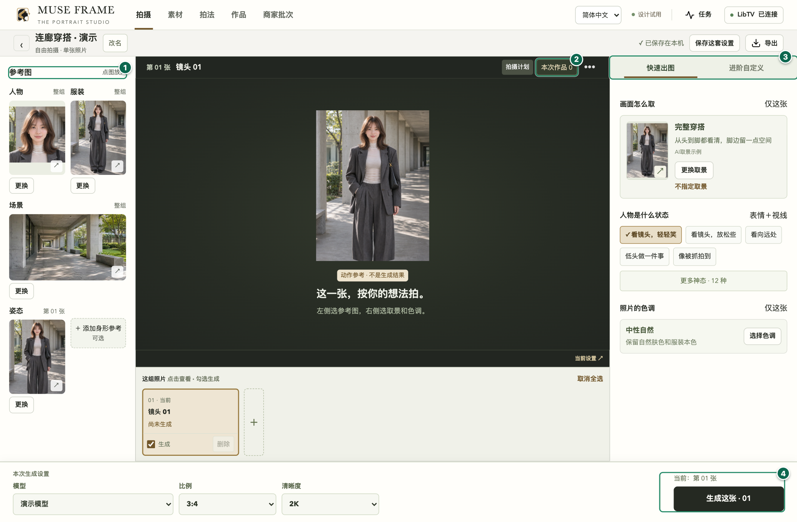
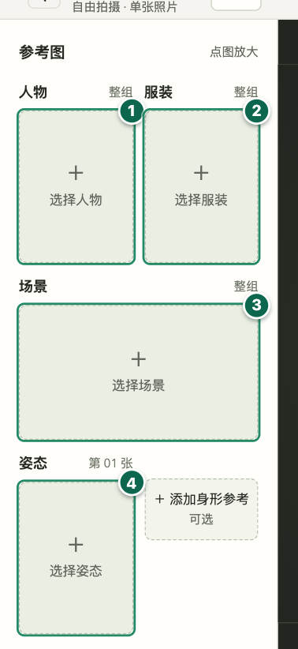
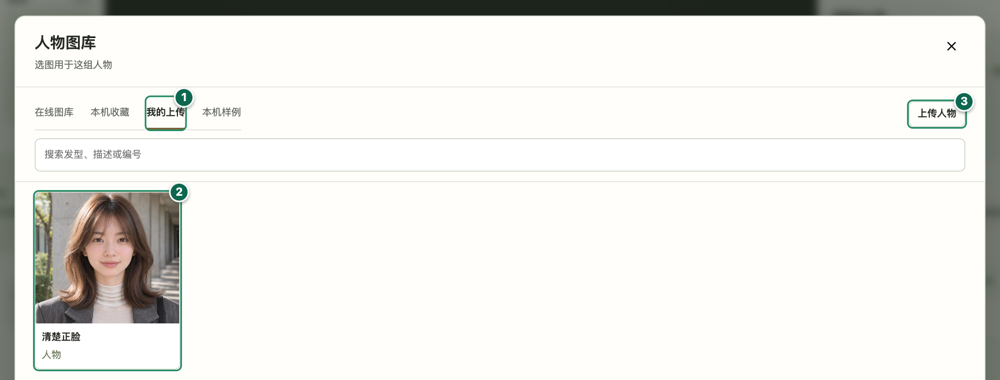
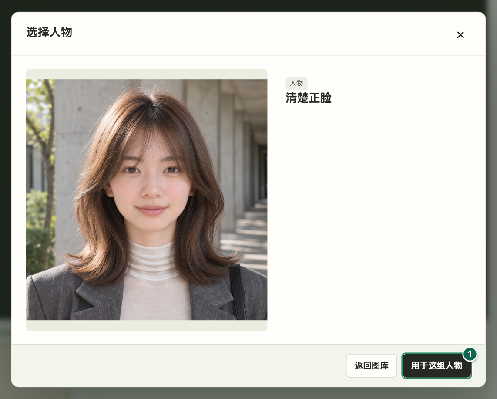
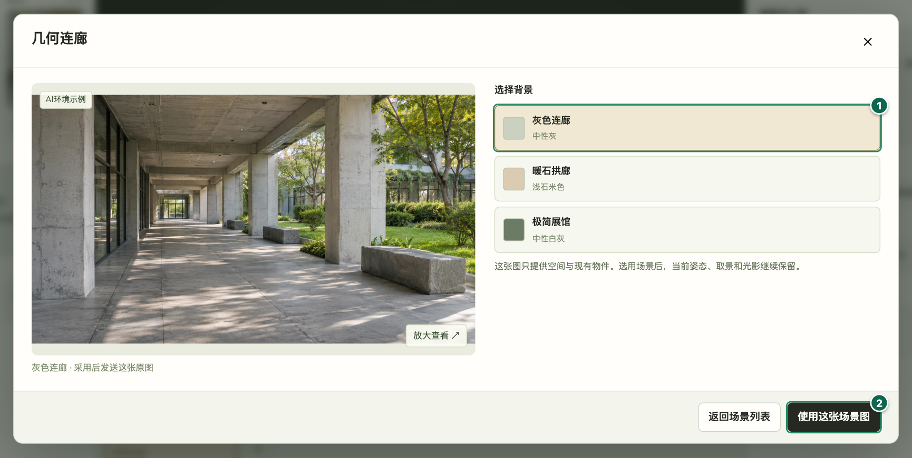
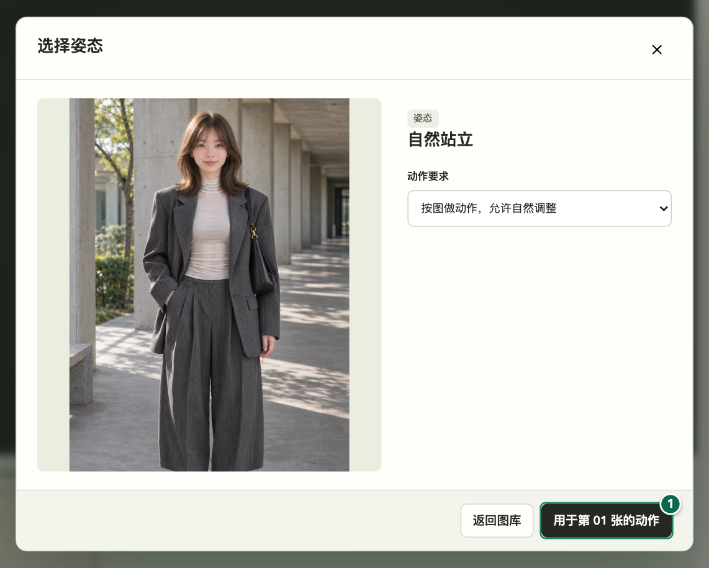
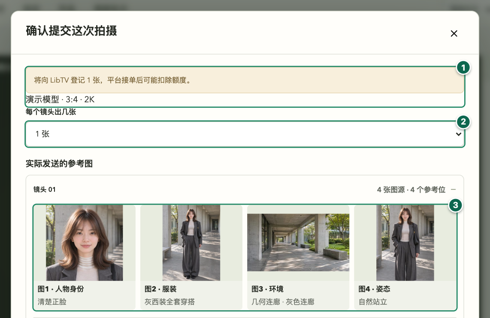
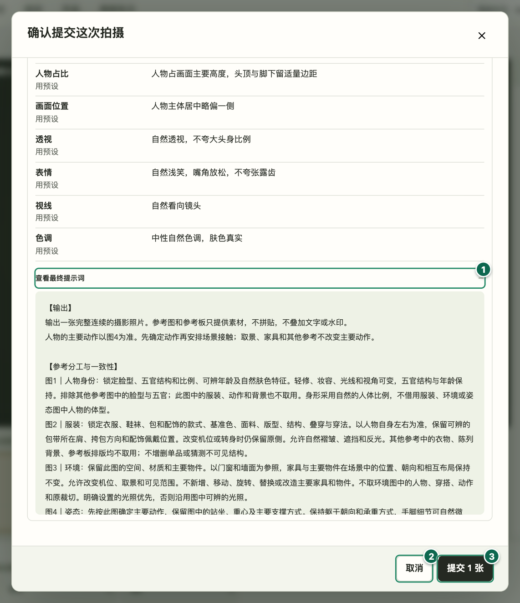
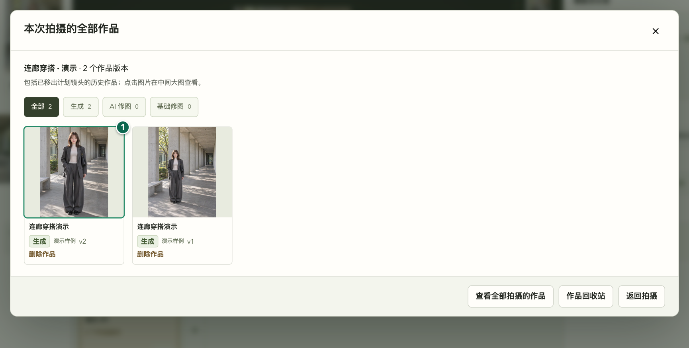
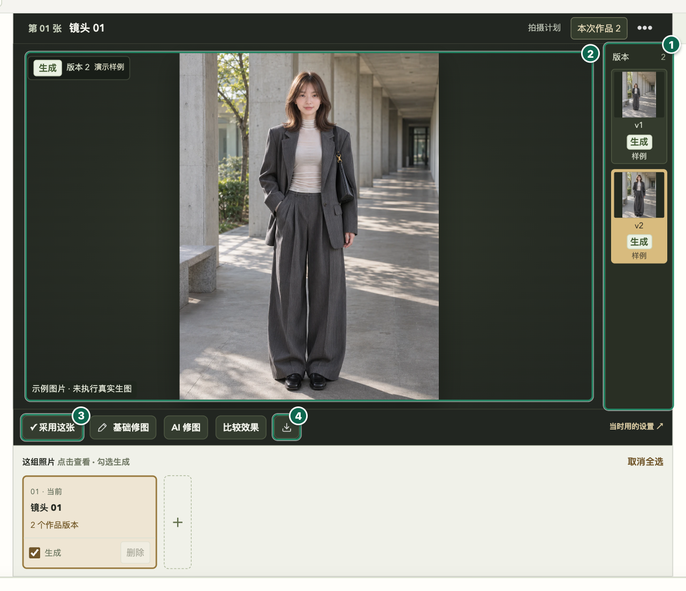

# 映象所 WebUI 使用教程

适用于 0.5.0-beta.5。用一次社媒穿搭拍摄练习，从四张参考图开始，生成一张，最后选片、下载原图。

[下载 Mac 或 Windows 版](https://github.com/KaneGong/muse-frame/releases/tag/v0.5.0-beta.5) · [安装、迁移和回退](quick-start.md) · [English](../en/webui-guide.md)

截图来自独立演示工作区，模型和作品均为示例。本次演示没有向平台提交生图任务。

## 1. 打开工作台

- **Apple 芯片 Mac** 打开 DMG，将 Muse Frame 拖进「应用程序」，再打开应用。
- **Windows x64** 双击 Setup，安装后可从开始菜单打开。
- 工作台在默认浏览器中打开。右上角的语言菜单可切换简体中文和 English。顶部「拍摄」能回到拍摄列表。已有用户可点「继续拍摄」，新用户可点「自由拍摄」创建单镜头。

### 三栏和底部生成区

1. 左栏「参考图」用来选人物、服装、场景和姿态。
2. 中间「拍摄计划」查看当前镜头，「本次作品」打开本次拍摄的结果。
3. 右栏点「快速出图」。本例用完整穿搭、看镜头轻轻笑、中性自然。
4. 底部选模型、比例、清晰度，再点右侧「生成这张」。此时先进入核对页。

## 2. 选四张参考图

左栏每个位置只负责一件事。本例准备一张人物正脸、一张完整穿搭、一张室内背景和一张站姿。

| 左栏位置 | 本例怎么选 | 交给模型参考什么 |
| --- | --- | --- |
| 人物 | 选一张脸清楚的图 | 脸型、五官和人物身份 |
| 服装 | 选能看清整套衣服、鞋包和穿法的图 | 服装款式、颜色、叠穿和配饰 |
| 场景 | 选一个室内背景，点进详情采用具体背景图 | 空间、已有物件与布局 |
| 姿态 | 选站立动作，在动作卡里选角度 | 当前镜头的站姿、身体朝向和接触点 |

人物、服装和姿态支持在线图库，也可以上传自己的图片。人物图库可先按分类缩小范围，姿态图库同一动作可切换角度。点左栏已选图片能放大核对。人物、服装和场景用于整组，姿态按镜头设置。可在确认页检查每张实际发送的原图。

### 四个入口分别选什么

1. 点「选择人物」，选正脸清楚的图。
2. 点「选择服装」，选能看清衣服、鞋包和穿法的图。
3. 点「选择场景」，选空间和现有物件清楚的背景。
4. 点「选择姿态」，为第 01 张选自然站姿。身形参考可先留空。

### 打开人物图库，选一张图

1. 点「我的上传」查看已有图片。也可从「在线图库」挑选。
2. 点想用的图片，进入大图详情。
3. 还没导入时，点「上传人物」选本机图片。服装图库用同样的方法。

### 看清正脸，再应用到整组

1. 点「用于这组人物」。回到左栏后，服装也要选图并点「用于这组服装」。

### 选一张具体背景

1. 从「选择场景」进入「几何连廊」，点「灰色连廊」。也可以从场景列表上传自有背景。
2. 点「使用这张场景图」。回到左栏看到该图，就已应用到整组。

### 把动作应用到当前镜头

1. 点「用于第 01 张的动作」。本例从「我的上传」选择站姿。在线动作若有多视角，先选角度再采用。

## 3. 在右栏设置怎么拍

选「快速出图」。在「画面怎么取」选「完整穿搭」，在「人物是什么状态」选「看镜头，轻轻笑」，在「照片的色调」选「中性自然」。这样第一张就有清楚的目标：站着拍全身，轻轻笑，尽量保留真实肤色和衣服颜色。

如果想先挑一整套拍法，从「拍摄 → 新建拍摄」查看推荐方案。如果想细调，切到「进阶自定义」，再增加光影或可选身形参考，或只改当前镜头。部分设置可跟随整组、采用预设、自定义或不写入。第一次建议先保留四张参考，看到结果后再调整一个选项。

## 4. 连接平台并核对这一张

1. 点右上「绘图平台」，选 **Lovart** 或 **LibTV**，点「平台授权」，在平台页面完成自己的账号授权。
2. 回到工作台，点「连接／刷新目录」，确认显示「已连接」。在底部选模型，等它支持的比例和清晰度载入后再选参数。例如想发社媒竖图，可以先看这个模型是否提供 3:4。
3. 点「生成这张」。在「确认提交这次拍摄」中查看平台、模型、参数、张数、「实际发送的参考图」以及提示词。依次确认人物、服装、场景、姿态的图号和缩略图；如果加了身形，按确认页的五图顺序核对。
4. 第一次把每个镜头设为 1 张。图或文字有误时点「取消」回去修正。确认无误后点「提交 1 张」。这一步才会把图片和提示词送往平台，接单后可能扣除额度。

### 核对平台、张数和实际参考图

1. 从底部点「生成这张」后，核对平台、模型、比例和清晰度。这里用 3:4、2K 演示。
2. 第一次把「每个镜头出几张」设为 1 张。
3. 按图 1 人物、图 2 服装、图 3 环境、图 4 姿态，对照缩略图逐张检查。

### 展开最终提示词，再决定是否提交

1. 往下滚动，点「查看最终提示词」，核对每张图的用途和写入的拍摄选项。
2. 有一项不对就点「取消」，回工作台改完再核对。
3. 全部确认后点「提交 1 张」。这一步才会把图片和提示词发给平台，平台接单后可能扣除额度。

## 5. 看任务、选片和保存原图

- 点顶部「任务」查看提交和出图进度。失败时先读原因；如果显示「待核对」，先核对原平台记录，再决定是否重试，避免重复登记或扣费。
- 出片后，在当前镜头切换各作品版本，或用「本次作品」看这次拍摄的所有结果。点图可放大检查脸、衣服和细节。先确认脸仍是同一个人，服装与配饰没有明显变化，再看姿态和场景接触是否自然。
- 满意就点「采用这张」。用下载图标保存当前原图；导出入口可打包已采用的作品和清单。如果只想调亮一点，用「基础修图」在本机处理并保存为新版本。需要改画面内容时用「AI 修图」，核对图片和修改要求后再提交平台。

### 从本次作品打开结果

1. 出片后，点中间栏上方的「本次作品」，再点一张缩略图回到大图。

### 检查版本、放大并保存原图

1. 点大图右边的 v1、v2，选中要看的版本。
2. 点大图放大，看脸、衣服和姿态接触点。滚轮可放大，左键拖动看细节。
3. 满意可点「采用这张」。
4. 点大图下方的下载图标，选择保存文件夹。下载的是当前版本；保存前先确认版本。

## 6. 备份和升级

打开「拍摄 → 工作区迁移与备份」可以检查旧工作区、备份到文件夹、迁入新版或回退。已有 0.5.0 WebUI 用户替换应用前，先等活动任务结束并点「退出本机工作台」，再打开新版。同一资料目录会继续使用。接续旧桌面版时请先检查旧工作区的文件和记录数量，再复制迁入。

[安装、迁移和回退](quick-start.md#升级迁移与回退) · [隐私](privacy.md) · [兼容性](compatibility.md)
